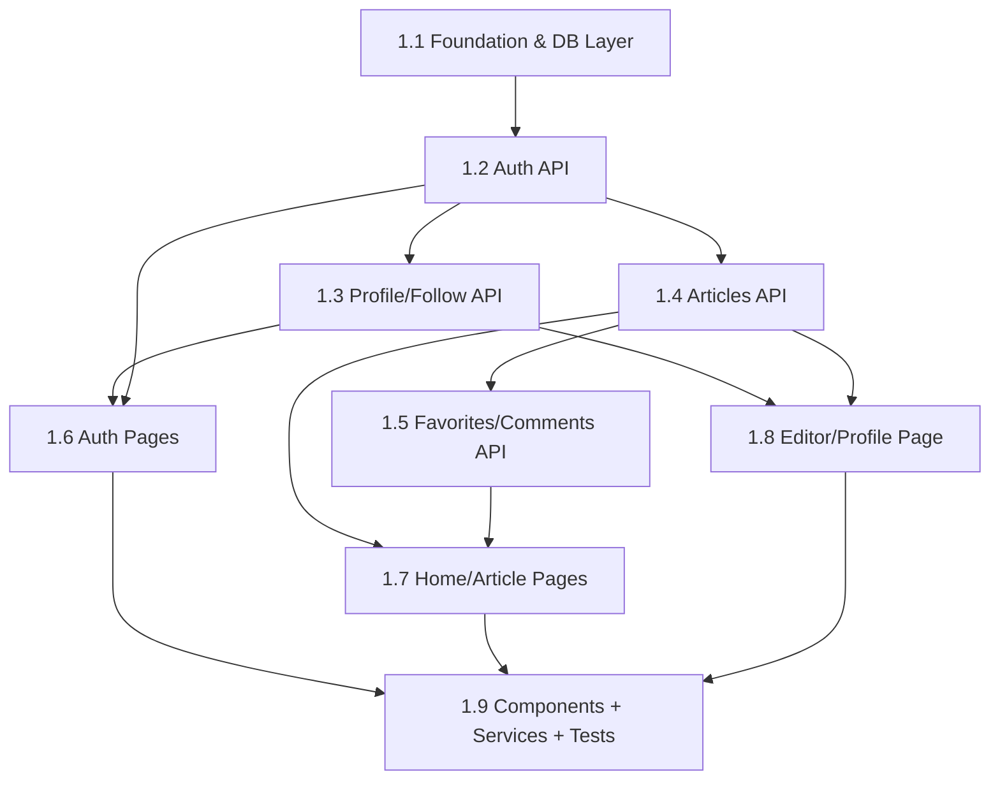

# aire State Tracking

## Project Information
- **Project Type**: Brownfield
- **Start Date**: 2026-09-09T06:16:42Z
- **Current Stage**: PLANNING - Workspace Detection

## Workspace State
- **Existing Code**: Yes
- **Programming Languages**: JavaScript (ES Modules)
- **Build System**: npm workspaces (backend/, frontend/)
- **Project Structure**: Decoupled full-stack monorepo (React SPA + Express MVC API)
- **Workspace Root**: /Users/revanta.biswas/Desktop/conduit-helix-test
- **Reverse Engineering Needed**: No — Atlas deep dive doc pulled directly

## Code Location Rules
- **Application Code**: `src/` for all NEW code (the migration target `conduit-next/` per the epic brief will be created under `src/conduit-next/` unless design stages decide otherwise)
- **Documentation**: spec/ only
- **Structure patterns**: See code-generation.md Critical Rules

## Code Root
- **Type**: monorepo (existing) — new code goes to `src/`
- **Path(s)**: backend/ (existing, untouched during migration until cutover), frontend/ (existing, untouched during migration until cutover), src/ (NEW Next.js app target)
- **Recorded**: 2026-09-09T06:16:42Z
- **Note**: Existing `backend/` and `frontend/` workspaces are the CURRENT system being migrated away from — left in place per the phased migration plan until Phase 3 cutover. All NEW Next.js application code goes into `src/` per AIRE's directory-structure rule (the migration plan's own `conduit-next/` naming is treated as `src/`).

## Tracker
- Type: GITHUB
- Parent Epic: Milestone #2 — "Epic: Next.js App Router Migration (Phases 0-2)"
- Epic URL: https://github.com/revanta-biswas/conduit-helix-test/milestone/2
- Project Key / Repo / Org: revanta-biswas/conduit-helix-test
- GitHub Username: revanta-biswas

## Context Project
- **Existing Knowledge**: No
- **Existing Knowledge Path(s)**: —
- **New References**: No
- **New Reference Path(s)**: —

## Existing-System Context
- **Workspace type**: migration
- **Helix MCP**: connected
- **Source**: atlas
- **Components in scope**: whole estate (backend/, frontend/, PostgreSQL via Sequelize) — full migration scope per epic brief
- **Atlas deep dive doc**: spec/plans/atlas-deep-dive.md
- **Recorded**: 2026-09-09T06:16:42Z

## Helix MCP Binding
- **Server**: helix
- **Docs tool(s)**: mcp__helix__get_solution_document_tool, mcp__helix__list_solution_documents_tool — fetches solution documents (System Exploration deep dive, Migration Strategy) by ID
- **Graph/Search tool(s)**: mcp__helix__codebase_agent_query, mcp__helix__codebase_cypher_query, mcp__helix__document_chatbot_query — natural-language / Cypher / RAG queries over the codebase graph and docs
- **Estate / workspace id**: solution_id 960 (conduit-helix-test)
- **Resolved**: 2026-09-09T06:16:42Z

## CI Configuration
- **CI Pipeline Generation**: SKIPPED (user explicit request — "skip ci for this entirely only development")
- **SonarQube Gate**: SKIPPED
- **Epic-level smoke test (smoke-test-epic)**: SKIPPED
- **Note**: All other gates (unit tests, coverage, Gherkin/behavior, D1-D7 static, judge gates run locally via dev-implement) still apply. Only the generated GitHub Actions CI pipeline and its associated setup gates are omitted for this cycle.

## Branching
- Base Branch: main
- Epic Branch: epic/nextjs-migration
- Epic PR: (not raised — raised manually at cycle end via pr-generator)
- Pushed: 2026-09-09T06:27:00Z (commit bde6488)

## Extension Configuration
| Extension | Enabled | Decided At |
|---|---|---|
| Property-Based Testing | No | Requirements Analysis |
| Resiliency Baseline | No | Requirements Analysis |
| Security Baseline | Yes (always mandatory) | Workflow start |
| Playwright Test Automation | Yes (always mandatory) | Workflow start |

## Migration Decisions (from Requirements Analysis)
- **Language**: JavaScript (not TypeScript) — matches current codebase
- **Styling**: Port existing CSS as-is — no Tailwind adoption
- **ORM**: Sequelize retained, models ported as-is (no Prisma switch)
- **Cutover scope this cycle**: Phase 0-2 only (Setup, API, Frontend) — working app in `src/`. Phase 3 (decommissioning old `backend/`/`frontend/`, production deploy/DNS) is a manual follow-up outside this AIRE cycle.

## Story Planning
- team_size: 2
- story_creation_mode: all-at-once
- target_story_count: 9 (user override; recommended was 22)

## Story Tracker
| Story ID | Title | Requires | Tracker ID | Status | PR | Merged | Start | End | Recorded |
|---|---|---|---|---|---|---|---|---|---|
| 1.1 | Next.js Foundation & Database Layer | none | #19 | 🧪 Ready for Testing | [#28](https://github.com/revanta-biswas/conduit-helix-test/pull/28) | yes | 2026-09-09 | 2026-09-11 | 2026-09-11 11:25 |
| 1.2 | Auth API — Register, Login & httpOnly Cookie Session | 1.1 | #20 | 🧪 Ready for Testing | [#29](https://github.com/revanta-biswas/conduit-helix-test/pull/29) | yes | 2026-09-09 | 2026-09-11 | 2026-09-11 11:25 |
| 1.3 | User Profile API — Current User, Public Profiles & Follow | 1.2 | #21 | 🧪 Ready for Testing | [#30](https://github.com/revanta-biswas/conduit-helix-test/pull/30) | yes | 2026-09-09 | 2026-09-11 | 2026-09-11 11:25 |
| 1.4 | Articles API — CRUD, Feed & Tags | 1.2 | #22 | 🧪 Ready for Testing | [#31](https://github.com/revanta-biswas/conduit-helix-test/pull/31) | yes | 2026-09-09 | 2026-09-11 | 2026-09-11 11:25 |
| 1.5 | Favorites & Comments API | 1.4 | #23 | 🧪 Ready for Testing | [#32](https://github.com/revanta-biswas/conduit-helix-test/pull/32) | yes | 2026-09-09 | 2026-09-11 | 2026-09-11 11:25 |
| 1.6 | Auth Pages & Session — Login, Register, Settings | 1.2, 1.3 | #24 | 🧪 Ready for Testing | [#33](https://github.com/revanta-biswas/conduit-helix-test/pull/33) | yes | 2026-09-09 | 2026-09-11 | 2026-09-11 11:25 |
| 1.7 | Home & Article Pages (Server Components) | 1.4, 1.5 | #25 | 🧪 Ready for Testing | [#35](https://github.com/revanta-biswas/conduit-helix-test/pull/35) | yes | 2026-09-10 | 2026-09-11 | 2026-09-11 11:25 |
| 1.8 | Article Editor & Profile Page | 1.3, 1.4 | #26 | 🧪 Ready for Testing | [#34](https://github.com/revanta-biswas/conduit-helix-test/pull/34) | yes | 2026-09-09 | 2026-09-11 | 2026-09-11 11:25 |
| 1.9 | Shared UI Components, Service Layer Elimination & Test Baseline | 1.6, 1.7, 1.8 | #27 | 🧪 Ready for Testing | [#36](https://github.com/revanta-biswas/conduit-helix-test/pull/36) | yes | 2026-09-10 | 2026-09-11 | 2026-09-11 11:25 |

## Dependency Graph

**Ready now (no prerequisites)**: 1.1 only.
**After 1.1 merges**: 1.2 becomes ready.
**After 1.2 merges**: 1.3 and 1.4 both become ready — 2 stories in parallel (meets team_size=2 target).
**After 1.4 merges**: 1.5 becomes ready (in addition to whichever of 1.3/1.6/1.8 are still open).
**After 1.3 + 1.4 merge**: 1.8 becomes ready. After 1.2 + 1.3 merge: 1.6 becomes ready. After 1.4 + 1.5 merge: 1.7 becomes ready.
**Last**: 1.9 requires 1.6, 1.7, and 1.8 all merged.

## Stage Progress
- [x] Workspace Detection
- [x] Requirements Analysis
- [x] User Stories
- [x] Dependency Graph
- [x] Workflow Planning
- [x] Application Design — EXECUTE
- [x] Functional Design — EXECUTE (light)
- [x] NFR Requirements — EXECUTE (light)
- [x] NFR Design — EXECUTE (light, folded into nfr.md)
- [x] Infrastructure Design — SKIP (no infra changes in scope)
- [x] STOP CHECKPOINT — architecture.md v1.0.0 + rubrics written; CI generation SKIPPED per user request
- **Design complete — awaiting dev-implement**
