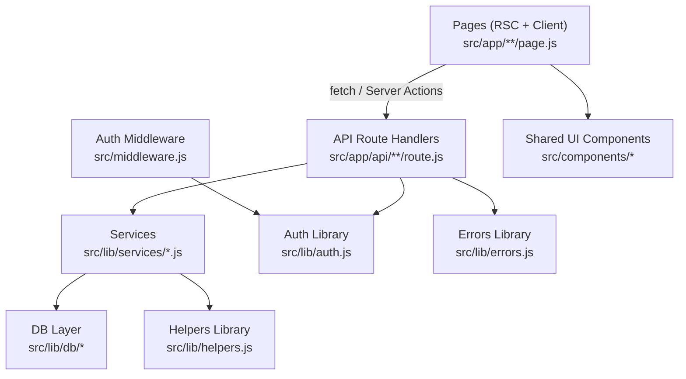

# Application Design: conduit-helix-test Next.js Migration

**Design reference note**: No UX wireframes/mockups/API specs were supplied this cycle (Context Opt-In
declined at Workspace Detection) — every component below is grounded in `spec/plans/requirements.md`,
`spec/plans/stories.md`, and `spec/plans/atlas-deep-dive.md` (the existing system's own component
inventory) only. `Design reference: none covers this component — built from ACs only` applies to every
component in this document.

**Service layer decision** (Application Design Question 1): **Thin Route Handlers + service functions**
— `src/lib/services/*.js` hold business logic, mirroring the current `controllers/*.js` pattern.
Route Handlers parse the request, call one service function, shape the response. This keeps a direct
line from each ported controller to its new service module and keeps business logic unit-testable
without spinning up Next.js's HTTP layer.

---

## Components

| Component | Location | Purpose | Ports From |
|---|---|---|---|
| DB Layer | `src/lib/db/models/*.js`, `src/lib/db/index.js`, `src/lib/db/config.js` | Sequelize models, singleton connection, config | `backend/models/`, `backend/config/config.js` |
| Auth Library | `src/lib/auth.js` | Verify session cookie, resolve current user, sign/set cookie on login/register | `backend/middleware/authentication.js`, `backend/helper/jwt.js`, `backend/helper/bcrypt.js` |
| Auth Middleware | `src/middleware.js` | Next.js Middleware — runs auth.js on protected routes, attaches user to request context | `backend/middleware/authentication.js` |
| Error Library | `src/lib/errors.js` | Typed error hierarchy (`MyError`, `ForbiddenError`, `NotFoundError`, `UnauthorizedError`, etc.) | `backend/helper/customErrors.js` |
| Helpers Library | `src/lib/helpers.js` | `slugify`, and the fixed (non-N+1) `appendFollowers`/`appendFavorites`/`appendTagList` replacements built as eager-load query helpers | `backend/helper/helpers.js` |
| Users Service | `src/lib/services/users.js` | Register, login business logic | `backend/controllers/users.js` |
| User Service | `src/lib/services/user.js` | Get/update current user | `backend/controllers/user.js` |
| Profiles Service | `src/lib/services/profiles.js` | Get public profile, follow/unfollow toggle | `backend/controllers/profiles.js` |
| Articles Service | `src/lib/services/articles.js` | Article CRUD, feed, tag association, eager-loaded enrichment | `backend/controllers/articles.js` |
| Favorites Service | `src/lib/services/favorites.js` | Favorite/unfavorite toggle | `backend/controllers/favorites.js` |
| Comments Service | `src/lib/services/comments.js` | Comment CRUD | `backend/controllers/comments.js` |
| Tags Service | `src/lib/services/tags.js` | List all tags | (new — was inline in `backend/routes/`) |
| API Route Handlers | `src/app/api/**/route.js` | Thin — parse request, call the matching service, shape JSON response + status code | `backend/routes/*.js` |
| Home Page (RSC) | `src/app/(home)/page.js` | Server Component — fetch feed, render list + pagination + tags sidebar | `frontend/src/routes/Home.jsx` |
| Article Page (RSC) | `src/app/article/[slug]/page.js` | Server Component — fetch article + comments, render markdown body | `frontend/src/routes/Article/Article.jsx` |
| Editor Pages (Client) | `src/app/editor/page.js`, `src/app/editor/[slug]/page.js` | Client Component — create/edit form, calls Articles API | `frontend/src/routes/ArticleEditor.jsx` |
| Profile Page (RSC) | `src/app/profile/[username]/page.js` | Server Component — user's articles/favorites tabs, follow action | `frontend/src/routes/Profile/Profile.jsx` |
| Login/Register Pages (Client) | `src/app/login/page.js`, `src/app/register/page.js` | Client Component — auth forms | `frontend/src/routes/Login.jsx` |
| Settings Page (Client) | `src/app/settings/page.js` | Client Component — profile update form | `frontend/src/routes/Settings.jsx` |
| Shared UI Components | `src/components/*` | ~20 ported presentational components (Navbar, ArticlesPreview, FavButton, etc.) | `frontend/src/components/*` |

## Component Methods (signatures — business rules detailed in Functional Design)

### Auth Library (`src/lib/auth.js`)
- `signSession(user) -> jwtToken: string` — sign a JWT for the given user
- `setSessionCookie(response, jwtToken) -> void` — attach httpOnly cookie to a Response
- `getSessionUser(request) -> user | null` — verify cookie, resolve user; returns `null` (not a throw) for soft-auth endpoints
- `requireSessionUser(request) -> user` — same as above but throws `UnauthorizedError` if absent (hard-auth endpoints)
- `clearSessionCookie(response) -> void` — logout

### Services (one file per resource group, methods mirror the current controller exports 1:1)
- `usersService.register(input) -> user`, `usersService.login(credentials) -> user`
- `userService.getCurrent(userId) -> user`, `userService.update(userId, changes) -> user`
- `profilesService.getProfile(username, viewerId?) -> profile`, `profilesService.toggleFollow(username, viewerId, follow: boolean) -> profile`
- `articlesService.list(filters) -> {articles, articlesCount}`, `articlesService.feed(userId, pagination) -> {articles, articlesCount}`, `articlesService.create(userId, input) -> article`, `articlesService.get(slug, viewerId?) -> article`, `articlesService.update(slug, userId, changes) -> article`, `articlesService.delete(slug, userId) -> void`
- `favoritesService.toggle(slug, userId, favorite: boolean) -> article`
- `commentsService.list(slug) -> comments[]`, `commentsService.create(slug, userId, body) -> comment`, `commentsService.delete(slug, commentId, userId) -> void`
- `tagsService.list() -> tags[]`

### Helpers (`src/lib/helpers.js`) — the N+1 fix, as method signatures
- `slugify(title) -> slug: string` (unchanged from current)
- `articleIncludeOptions(viewerId?) -> Sequelize include array` — the eager-load replacement for the old per-article `appendFollowers`/`appendFavorites`/`appendTagList` loop; passed to `Article.findAll({ include: articleIncludeOptions(viewerId) })` so followers/favorites/tags are joined in the same query instead of N follow-up queries

## Services — Orchestration Patterns

- **Route Handler → Service → Model** is the only call chain. Route Handlers never call Sequelize models directly (mirrors the current Route → Controller → Model layering, keeps the 1:1 port mapping traceable).
- **Auth is cross-cutting**, not a service: every protected Route Handler calls `requireSessionUser(request)` (or `getSessionUser` for soft-auth) before invoking its service function — this mirrors the current `verifyToken` middleware being applied per-route rather than globally.
- **No service calls another service directly across resource groups** in this cycle (e.g., Articles Service does not import Profiles Service) — where enrichment needs cross-resource data (e.g., an article's `favorited`/`author.following` flags), it is expressed as a single eager-loaded query in the Articles Service itself (via the Helpers Library's include builder), not a service-to-service call. This preserves the N+1 fix's whole point: one query, not one call-chain per related entity.

## Component Dependencies

**Data flow (example — Article feed request)**:
1. `Pages` (Home, RSC) calls `fetch('/api/articles')` server-side.
2. `RouteHandlers` (`src/app/api/articles/route.js`) calls `AuthLib.getSessionUser(request)` (soft auth) then `Services.articlesService.list(filters)`.
3. `Services` calls `DBLayer` via `Article.findAll({ include: HelpersLib.articleIncludeOptions(viewerId) })` — one query, eager-loaded.
4. Response shaped to match the Conduit API spec, returned to the Page, rendered server-side.

## Design Completeness Check

- Every REQ-F/REQ-NF ID from `requirements.md` maps to at least one component above (Setup → DB Layer; Auth → Auth Library/Middleware; API resource groups → their Services + Route Handlers; Pages → the 6 page components + Shared UI Components).
- Every story (1.1-1.9) in `stories.md` maps to a coherent subset of these components — no story requires a component not listed here, and no component here is orphaned (unused by any story).
- Consistent with `spec/plans/atlas-deep-dive.md`'s existing component inventory — each new component's "Ports From" column names its exact current-system origin.
