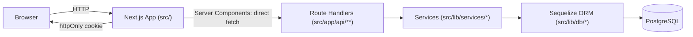

# Architecture — conduit-helix-test Next.js Migration

> **Version**: 1.0.0 · **Generated**: 2026-09-09T06:42:28Z · **AIRE**: v1.0
> **Derived from**: spec/plans/atlas-deep-dive.md, spec/plans/epic-brief.md, spec/plans/requirements.md, spec/plans/application-design.md, spec/plans/functional-design.md, spec/plans/nfr.md
> **Existing-system baseline**: Atlas via Helix MCP · solution_id 960 (conduit-helix-test)

## 1. System Context

conduit-helix-test is a Conduit/RealWorld-spec blogging platform (articles, comments, profiles,
follows, favorites, tags). It currently ships as a decoupled React SPA (`frontend/`) talking to an
Express.js MVC REST API (`backend/`) over `/api/*`, backed by PostgreSQL via Sequelize. This
migration replaces both halves with a single Next.js 15 App Router application (`src/`), which is the
ONLY thing this document describes going forward — `backend/` and `frontend/` remain live and
unmodified for the duration of this cycle (Phase 3 decommissioning is out of scope).

No external third-party APIs, queues, or cloud services are consumed — PostgreSQL is the only
integration point, unchanged from the current system.

## 2. Component Inventory

| Component | Responsibility | Status | Source |
|---|---|---|---|
| DB Layer (`src/lib/db/*`) | Sequelize models, singleton connection, config | new (ported logic) | application-design.md |
| Auth Library (`src/lib/auth.js`) | Sign/verify session cookie, resolve current user | new (ported logic) | application-design.md, functional-design.md |
| Auth Middleware (`src/middleware.js`) | Enforce auth on protected routes | new (ported logic) | application-design.md |
| Errors Library (`src/lib/errors.js`) | Typed error hierarchy | new (ported verbatim) | application-design.md |
| Helpers Library (`src/lib/helpers.js`) | slugify, eager-load include builder (N+1 fix) | new (ported + redesigned) | functional-design.md |
| Users/User/Profiles/Articles/Favorites/Comments/Tags Services (`src/lib/services/*`) | Business logic per resource group | new (ported logic) | application-design.md |
| API Route Handlers (`src/app/api/**/route.js`) | Thin HTTP adapters over Services | new | application-design.md |
| Home, Article, Editor, Profile, Login, Register, Settings pages (`src/app/**/page.js`) | Server/Client Components per page | new (ported UI/behavior) | application-design.md |
| Shared UI Components (`src/components/*`) | ~20 ported presentational components | existing (ported as-is) | atlas-deep-dive.md |
| `backend/`, `frontend/` (existing) | Current live system | existing (untouched) | atlas-deep-dive.md |

## 3. Layering and Boundaries

- **Route Handlers never call Sequelize models directly.** They call exactly one Service function,
  then shape the HTTP response. This is the single hard layering rule for the API side.
- **Services never call Sequelize `include` per-row in a loop.** List/feed-returning Service methods
  use a single eager-loaded query (via the Helpers Library's include builder) — this is the load-bearing
  rule that keeps the N+1 fix real, not just documented.
- **Services do not call other Services across resource groups.** Cross-resource enrichment (e.g. an
  article's author-follow status) is expressed as part of the single eager-loaded query in the owning
  Service, never as a call chain (application-design.md, "Orchestration Patterns").
- **Auth is enforced in Route Handlers, not Services.** Every Route Handler calls
  `requireSessionUser`/`getSessionUser` before invoking its Service — Services trust that authorization
  has already been checked (this mirrors the current `verifyToken`-per-route pattern and keeps Services
  testable without an HTTP context).
- **Server Components fetch directly** (no client-side data-fetching library) — Client Components use
  Server Actions or `fetch` against the Route Handlers. No Axios, anywhere in `src/`.
- **`src/` is the only application code root for this cycle.** `backend/` and `frontend/` are read-only
  reference material (for porting) — no new code is added to either.

## 4. Data Architecture

- **Store**: PostgreSQL, unchanged schema, unchanged Sequelize CLI migrations (`backend/migrations/`,
  reused as-is — no new migration tooling introduced).
- **Ownership**: DB Layer (`src/lib/db/*`) is the sole owner of the Sequelize connection and model
  definitions; no other component instantiates Sequelize directly.
- **Schema changes**: none in this cycle. `sequelize.sync({ alter: true })` is removed from the startup
  path entirely (REQ-F-18) — the app calls `sequelize.authenticate()` only.
- **Transaction boundaries**: not newly introduced — the current system has no multi-step transactional
  operations requiring one (article+tag association is the closest candidate; it ports the existing
  non-transactional find-or-create-then-associate pattern unchanged, since introducing transactions
  here would be a functional change beyond this migration's scope).

## 5. API and Integration Contracts

- **Protocol**: REST over HTTP, JSON bodies — unchanged from the current system.
- **Contract**: every endpoint's request/response shape matches the existing Conduit/RealWorld API
  spec exactly (REQ-NF-04) — this is a hard constraint, not a preference; see Section 10, ARCH-04.
- **Error model**: `{ errors: { body: [...] } }`, unchanged, mapped from the ported typed error
  hierarchy (functional-design.md).
- **Auth model**: JWT, carried in an `httpOnly` cookie set by the login/register Route Handlers
  (replacing the current `Authorization: Token <jwt>` header + localStorage pattern). Existing external
  consumers of the current header-based auth are not a concern this cycle — there are none (single
  external service is PostgreSQL only, per atlas-deep-dive.md).
- **Versioning**: none — this is a like-for-like contract replacement, not a new API version.

## 6. Cross-Cutting Decisions

- **AuthN/AuthZ**: session resolved via httpOnly cookie + Next.js Middleware; authorization checks
  (e.g. "only the article's author may update/delete it") live in the owning Service, using the
  resolved user from the Route Handler.
- **Error handling**: the single ported error hierarchy is the only error vocabulary — no new ad-hoc
  error types (functional-design.md, "Error Handling").
- **Logging**: no structured logging framework introduced this cycle (matches the current system's
  console-based logging) — Sequelize query logging (`logging: console.log`) is used ONLY during
  development to verify the N+1 fix, never enabled in a committed default config for runtime use.
- **Configuration/secrets**: `.env.local` (Next.js convention) replaces `backend/.env` — same variable
  names/semantics (`DATABASE_URL`/`DB_*`, `JWT_SECRET`, `NODE_ENV`), no secret ever committed.
- **Observability**: not in scope this cycle (no production deployment).
- **Resilience patterns**: none newly introduced — this is a single-process, single-database app with
  no distributed-system resilience concerns.
- **Concurrency/idempotency**: favorite/follow toggles remain idempotent (functional-design.md), matching
  current behavior — no new idempotency mechanism introduced.

## 7. Non-Functional Targets

| Concern | Target | Source | How it is verified |
|---|---|---|---|
| N+1 query elimination | Feed/list requests use a bounded (not `1+3N`) query count | nfr.md, functional-design.md | Sequelize query logging during development (Story 1.4 AC) |
| Auth token exposure | JWT never in localStorage or a JS-readable location | nfr.md (REQ-NF-01) | Code review — no `localStorage` reference for auth in `src/` |
| Schema safety | No implicit schema alteration at boot | nfr.md (REQ-F-18) | Code review — no `sync({ alter: true })` call in `src/` |
| API contract parity | Every endpoint's request/response shape matches the current Conduit spec | nfr.md (REQ-NF-04) | Shadow-testing old vs new responses per story (Migration Strategy testing approach) |
| Dependency surface | No Axios, no react-router-dom in `src/` | nfr.md (REQ-NF-05) | Code review — dependency usage scan |
| Test coverage | New code has Vitest/RTL coverage as it is written | nfr.md (REQ-NF-06) | Unit test coverage gate (unitTestCoverageMin, per-story) |

## 8. Infrastructure and Deployment

Out of scope this cycle. No new infrastructure, no deployment topology change, no CI pipeline
generation (per explicit user request for this AIRE cycle — CI pipeline generation, SonarQube gate,
and the epic-level smoke test are all skipped). The app runs via `next dev` locally against the
existing PostgreSQL instance; production deployment is Phase 3, deferred outside this cycle.

## 9. Delta from the Existing System

| Area | Before (Atlas) | After | Reason |
|---|---|---|---|
| Codebase structure | Two workspaces (`backend/`, `frontend/`), two `package.json` | One `src/` Next.js app (backend + frontend unified); old workspaces untouched this cycle | Migration goal — unify DX |
| Auth token storage | `localStorage`, `Authorization: Token <jwt>` header | `httpOnly` cookie, Next.js Middleware | REQ-NF-01 — close XSS exposure |
| Article list/feed queries | `1 + 3N` queries (per-article `appendFollowers`/`appendFavorites`/`appendTagList` loop) | Single eager-loaded query via `include` | REQ-F-17/REQ-NF-02 — N+1 fix |
| Schema management | `sequelize.sync({ alter: true })` on every boot | `sequelize.authenticate()` only; Sequelize CLI migrations are the sole schema source | REQ-F-18 — remove production schema-alter risk |
| Auth validation | Non-empty checks only; no email format, no password length, no username uniqueness | Tightened: email format, 8-char password minimum, username format + uniqueness | Functional Design Q&A (user chose to tighten) |
| Frontend data fetching | 14 Axios service files | Direct `fetch` in Server Components / Server Actions | REQ-F-27/REQ-NF-05 |
| Frontend routing | React Router DOM | Next.js file-system routing | REQ-F-30 |
| Frontend state | `AuthContext` (localStorage-backed), `FeedContext` (client state) | Server-verified cookie session; URL search params for feed selection | REQ-F-28/REQ-F-29 |
| Rendering | Client-side SPA only | React Server Components for data-fetching pages | REQ-F-20/REQ-F-21 |
| Test coverage | 3 utility test files, near-zero | Vitest + RTL baseline covering models, Route Handlers, key components | REQ-F-40/REQ-NF-06 |

## 10. Verifiable Constraints

### ARCH-01 — Route Handlers never touch Sequelize directly
- **Constraint**: Every Next.js Route Handler under `src/app/api/**` calls a Service function for its
  business logic; it never imports or calls a Sequelize model directly.
- **Verifiable as**: Any changed file under `src/app/api/**/route.js` that imports from
  `src/lib/db/models/*` directly (rather than only importing from `src/lib/services/*`) scores 0.
- **Weight**: 0.20
- **Source**: spec/plans/application-design.md (Services — Orchestration Patterns)

### ARCH-02 — No N+1 query pattern in list/feed code paths
- **Constraint**: Any Service method that returns a list of Articles (feed, global list, tag/author/
  favorited filters) issues a single eager-loaded query using `include`, never a per-row follow-up
  query for followers, favorites, or tags.
- **Verifiable as**: Any changed Service method returning multiple Articles that contains a `.map`/
  `for...of`/`forEach` loop issuing an `await` DB call per iteration (e.g. `appendFollowers`-style
  per-article enrichment) scores 0.
- **Weight**: 0.20
- **Source**: spec/plans/functional-design.md (N+1 Fix — Detailed Design)

### ARCH-03 — Auth token never in localStorage
- **Constraint**: The JWT session token is set and read exclusively via an `httpOnly` cookie; no
  changed frontend code reads or writes it to/from `localStorage` or `sessionStorage`.
- **Verifiable as**: Any changed file under `src/` referencing `localStorage`/`sessionStorage` in
  connection with a token, user session, or JWT scores 0.
- **Weight**: 0.20
- **Source**: spec/plans/nfr.md (Security — REQ-NF-01)

### ARCH-04 — API response contract parity
- **Constraint**: Every Route Handler's success and error response shape matches the existing Conduit/
  RealWorld API spec exactly — same field names, same nesting, same error envelope
  `{ errors: { body: [...] } }`.
- **Verifiable as**: Any changed Route Handler whose response shape omits, renames, or restructures a
  field present in the corresponding current `backend/controllers/*.js` response (verified by reading
  the original controller) scores 0.
- **Weight**: 0.15
- **Source**: spec/plans/nfr.md (Non-Functional Targets — API contract parity)

### ARCH-05 — No unsafe schema sync
- **Constraint**: The Next.js app never calls `sequelize.sync({ alter: true })` (or `sync()` with any
  option that can alter the schema) anywhere in its startup or runtime path.
- **Verifiable as**: Any changed file under `src/` containing a `sequelize.sync(` call with `alter` or
  `force` set to a truthy value scores 0.
- **Weight**: 0.15
- **Source**: spec/plans/requirements.md (REQ-F-18)

### ARCH-06 — No Axios or react-router-dom in `src/`
- **Constraint**: No file under `src/` imports `axios` or `react-router-dom`.
- **Verifiable as**: Any changed file under `src/` with an `import ... from 'axios'` or
  `import ... from 'react-router-dom'` statement scores 0.
- **Weight**: 0.10
- **Source**: spec/plans/nfr.md (Maintainability — REQ-NF-05)

**Weights**: 0.20 + 0.20 + 0.20 + 0.15 + 0.15 + 0.10 = **1.00**

## 11. Explicitly Out of Scope

- Production deployment, DNS cutover, hosting configuration (Migration Strategy Phase 3).
- Decommissioning `backend/`/`frontend/` directories (Migration Strategy Phase 3).
- TypeScript adoption (Requirements Analysis Q1 — declined).
- Tailwind CSS adoption (Requirements Analysis Q2 — declined).
- Prisma / any ORM switch away from Sequelize (Requirements Analysis Q4 — declined).
- CI pipeline generation, SonarQube integration, epic-level smoke test (explicit user request for this
  cycle — "skip ci for this entirely only development").
- Property-Based Testing extension, Resiliency Baseline extension (both declined at Requirements
  Analysis).
- Accessibility audit / redesign (components ported as-is, no visual/interaction redesign in scope).
- Multi-environment / staging infrastructure, load testing, formal performance benchmarking beyond the
  informal dev-environment targets in Section 7.
