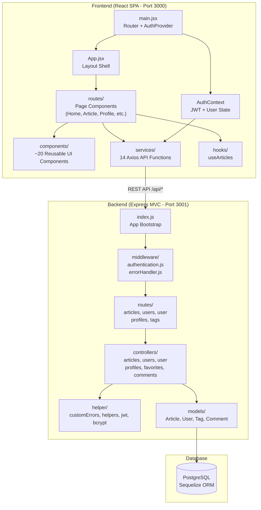
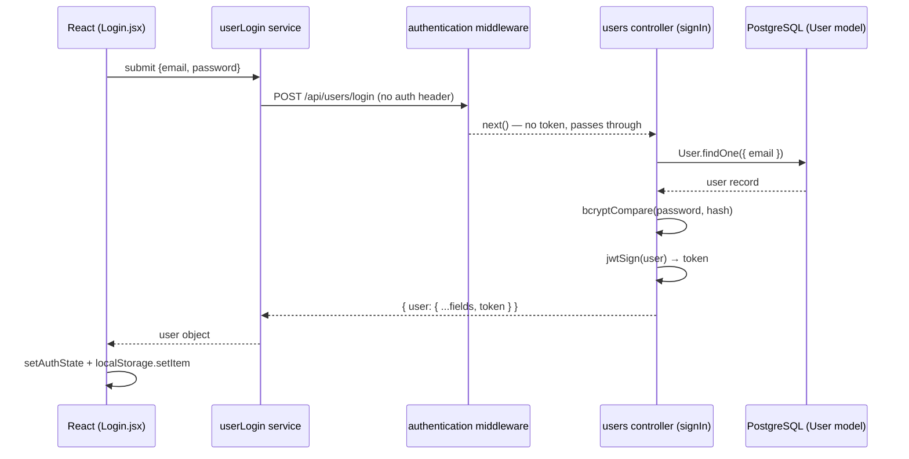
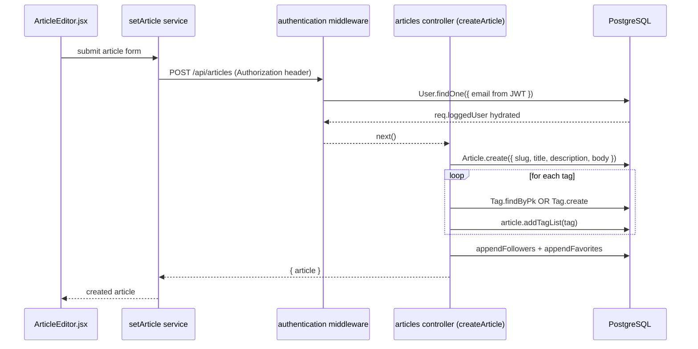

> **Source**: Atlas via Helix MCP
> **Server / tool**: helix · get_solution_document_tool (System Exploration document)
> **Estate**: conduit-helix-test (solution_id 960)
> **Scope pulled**: whole-repo deep dive — full-stack Conduit reference app (frontend + backend + DB)
> **Fetched**: 2026-09-09T06:16:42Z
> **Freshness**: document updated 2026-09-07T08:53:47Z (not re-run at fetch time)

# System Exploration: conduit-helix-test

**Created:** 2026-09-07
**For:** Revanta
**Exploration Depth:** Deep
**Status:** COMPLETE
**Steps Completed:** 10 of 10

> **Purpose:** Comprehensive system exploration providing deep understanding of architecture, flows, dependencies, components, and actionable recommendations.

---

## Executive Summary

**conduit-helix-test** is a full-stack RealWorld Conduit reference implementation — a Medium-style blogging platform demonstrating CRUD, auth, pagination, and social features. Built with React 19 + Vite on the frontend and Express.js 5 + Sequelize + PostgreSQL on the backend, structured as an npm workspaces monorepo (~3,470 LOC across 128 files).

**Top 5 Findings:**

1. **Well-structured, modern stack on both ends** — React 19 + React Router 7 + Vite 7 (frontend) and Express v5 GA + Sequelize 6 + PostgreSQL (backend). All dependencies are at current major versions with no stale or deprecated libraries.
2. **Clean MVC architecture with a critical production risk** — The backend follows a textbook MVC pattern with proper layer separation, but `sequelize.sync({ alter: true })` runs on every boot — a production schema-altering risk that must be gated before any live deployment.
3. **N+1 query pattern is the primary performance bottleneck** — Article list and feed endpoints run `appendFollowers`, `appendFavorites`, and `appendTagList` per article in a loop. Acceptable at the current default limit of 3, but will degrade under load.
4. **Test coverage is critically thin** — Only 3 utility test files exist (2 frontend helpers, 1 backend helper). Zero route, controller, model, or React component tests. Not production-ready from a quality assurance standpoint.
5. **Documentation gaps are the highest-priority action item** — No API spec (Swagger/OpenAPI), no ADRs, no ERD, no deployment guide. The README is good for local setup but leaves a new developer on their own for everything else.

---

## System at a Glance

**What it is:** A full-stack RealWorld Conduit reference implementation — a Medium-style blogging platform with articles, comments, profiles, and tag-based feeds.

**Technology Stack:**

- **Primary Language:** JavaScript (ES Modules)
- **Frontend:** React 19.2.4 + React Router DOM 7.x, built with Vite 7.3.5 + SWC
- **Backend:** Express.js 5.2.1, Sequelize 6.37.8 ORM
- **Database:** PostgreSQL (pg 8.20.0)
- **Auth:** JWT (jsonwebtoken 9.0.3) + bcrypt 6.0.0
- **HTTP Client:** Axios 1.13.6 (frontend)
- **Build Tool:** npm workspaces monorepo + Vite (frontend), plain Node.js (backend)
- **Testing:** Vitest 4.0.18

**Architecture Style:** Decoupled full-stack monorepo — React SPA frontend over REST with Express.js MVC backend and Sequelize Active Record models.

**Quick Stats:**

| Metric | Value |
|--------|-------|
| Total Files | 128 |
| Lines of Code | ~3,470 |
| Test Files | 3 (very sparse) |
| Configuration Files | ~5 |
| Documentation Files | 2 (README, CODE_OF_CONDUCT) |

**Entry Points:**

- Frontend: `frontend/src/main.jsx`
- Backend: `backend/index.js`
- Dev (both): `npm run dev` (ports 3000 frontend / 3001 API)

**Documentation State:**

- ✅ **README:** Present and good quality — covers prerequisites, install, config, dev, testing, production
- ❌ **API Docs:** Absent — no Swagger/OpenAPI spec
- ❌ **Architecture Docs:** Absent — no ADRs or design docs
- ⚠️ **Inline Comments:** Very sparse — mostly route-label comments only
- ⚠️ **Test Coverage:** Only 3 test files covering 2 frontend helpers + 1 backend helper; no route/controller/component tests

---

## Architecture Analysis

### Architectural Style

Decoupled full-stack monorepo: a React SPA frontend communicates over REST with an Express.js MVC backend. Sequelize Active Record models handle data persistence against PostgreSQL. The two halves are independently runnable but deployed together in production (backend serves frontend's static build).

**Key Patterns:**
- **MVC (Backend):** Routes → Controllers → Sequelize Models — clean, well-enforced separation
- **Active Record (Models):** Sequelize models own their own associations and serialisation (`toJSON()` redacts sensitive fields like `id`, `userId`)
- **Service Layer (Frontend):** Thin one-function-per-API-operation service files (e.g. getArticles.js, toggleFav.js) — clean separation from UI
- **Context API for Auth:** `AuthContext` stores JWT + user state globally, hydrated from `localStorage` on load
- **Barrel Exports:** Every component has an `index.js` re-export (e.g. `frontend/src/components/Navbar/index.js`)
- **Centralized Error Handling:** Custom error class hierarchy (`MyError` → `ForbiddenError`, `NotFoundError`, `UnauthorizedError`, etc.) funnelled through a single Express error middleware

**Architectural Concerns:**
- ✅ Clean MVC separation on backend; thin service layer on frontend; typed error hierarchy; centralized auth middleware; no circular dependencies detected
- ⚠️ **N+1 Query Risk:** `backend/controllers/articles.js` calls `appendFollowers`, `appendFavorites`, and `appendTagList` per article in a loop — classic N+1 for list queries
- ⚠️ **No Repository Layer:** Controllers call Sequelize models directly — fine for this scale, but creates ORM coupling
- ⚠️ **`sequelize.sync({ alter: true })` on startup** — `backend/index.js` runs `alter: true` every boot, which can destructively alter production schema columns
- ℹ️ **`localStorage` JWT storage** — Standard for SPAs but vulnerable to XSS; worth a security review

### Core Components

| Component | Location | Responsibility |
|-----------|----------|----------------|
| App Bootstrap | `backend/index.js` | Express setup, route mounting, DB sync, CORS, static serving |
| Routes | `backend/routes/` | HTTP verb + path → controller mapping; selective auth middleware |
| Articles Controller | `backend/controllers/articles.js` | Largest controller (242 lines); all article CRUD + feed + enrichment |
| Users/User Controllers | `backend/controllers/users.js`, `user.js` | Registration, login, profile updates |
| Sequelize Models | `backend/models/` (Article, User, Tag, Comment) | DB schema, associations, field-level `toJSON()` redaction |
| Auth Middleware | `backend/middleware/authentication.js` | JWT verification; attaches `loggedUser` to `req` |
| Custom Errors | `backend/helper/customErrors.js` | Typed error class hierarchy for structured error responses |
| Helper Utilities | `backend/helper/helpers.js` | `slugify`, `appendFollowers`, `appendFavorites`, `appendTagList` |
| React Root | `frontend/src/main.jsx` | React Router tree setup, wraps app in `AuthProvider` |
| App Shell | `frontend/src/App.jsx` | Layout: `Navbar` + `<Outlet />` + `Footer` |
| Auth Context | `frontend/src/context/AuthContext.jsx` | Global JWT + user state via `useAuth()` hook |
| Service Layer | `frontend/src/services/` (14 files) | One Axios function per API operation |
| UI Components | `frontend/src/components/` (~20 components) | Reusable UI building blocks with barrel exports |

### Architectural Layers

| Layer | Frontend | Backend | Quality |
|-------|----------|---------|---------|
| **Presentation** | `routes/` page components + `components/` | — | ✅ Clean; routes compose components, no business logic |
| **Business Logic** | `services/` (thin HTTP adapters) | `controllers/` | ✅ Backend is authoritative; frontend services are thin |
| **Data Access** | — | `models/` (Sequelize Active Record) | ✅ Well-encapsulated; no leakage into routes |
| **Infrastructure** | `context/AuthContext` (auth state) | `middleware/`, `helper/`, `config/` | ✅ Cleanly separated |

### Architecture Diagram



---

## Critical System Flows

### Flow 1: User Authentication (Login)
`POST /api/users/login` → `verifyToken` (skipped, no auth header) → `signIn` controller → `User.findOne()` → `bcryptCompare()` → `jwtSign()` → `{ user: { token } }` response

- **Frontend entry:** `frontend/src/services/userLogin.js` calls `POST /api/users/login` with `{user:{email,password}}`
- **Auth middleware:** `verifyToken` is applied but soft — if no `Authorization` header, passes through via `next()`
- **Controller:** `signIn` in `backend/controllers/users.js` — finds user by email, compares bcrypt hash, signs JWT, returns full user object with token attached to `dataValues`
- **Frontend storage:** `AuthContext` stores the response in `localStorage` as `loggedUser` and sets `isAuth: true`
- **Key insight:** JWT is signed with the user object (not just ID). Every authenticated request re-queries the DB via `verifyToken` to hydrate `req.loggedUser` — no JWT caching.
- **Error handling:** Typed errors (`NotFoundError`, `ValidationError`) flow to `errorHandler` middleware



---

### Flow 2: Article Creation
`POST /api/articles` → `verifyToken` → `createArticle` → `slugify` → `Article.create()` → tag association loop → `appendFollowers` + `appendFavorites` → `{ article }` response

- **Frontend entry:** `frontend/src/services/setArticle.js` sends `POST /api/articles` with `Authorization: Token <jwt>`
- **Auth gate:** `verifyToken` decodes JWT, queries DB for user, attaches as `req.loggedUser`
- **Controller:** `createArticle` validates required fields, generates slug via `slugify()`, creates `Article` record, then iterates tags — finding or creating each `Tag` and associating via `TagList` join table
- **Enrichment:** After save, `appendFollowers` and `appendFavorites` are called to hydrate the response shape
- **Key insight:** Tag management is N+1 — one DB query per tag in the `tagList` array. No batch insert.
- **FIXME flag:** `Article.js` has `// FIXME: delete tags` on the cascade — orphan tag cleanup is a known gap



---

### Flow 3: Article Feed / Listing
`GET /api/articles` → `verifyToken` (optional auth) → `allArticles` → `Article.findAndCountAll()` → per-article enrichment loop → `{ articles, articlesCount }`

- **Frontend entry:** `getArticles.js` — called by `useArticles` hook with optional filters (`author`, `tag`, `favorited`, `limit`, `offset`)
- **Filtering:** All handled via Sequelize `where` clauses in `searchOptions` — author filter, tag filter, favorited-by-user filter (special case: loads user's favorites association)
- **Pagination:** `limit` (default 3) + `offset` controlled by query params; frontend uses `react-paginate`
- **N+1 risk:** The enrichment loop (`appendTagList`, `appendFollowers`, `appendFavorites`) runs sequentially per article — for large article sets this is the primary performance bottleneck
- **Key insight:** Unauthenticated users get articles too (verifyToken soft-passes); `favorited` and `following` fields default to `false` if no `loggedUser`

---

### Flow 4: Follow / Unfollow User
`POST|DELETE /api/profiles/:username/follow` → `verifyToken` (required) → `followToggler` → `profile.addFollower()` OR `profile.removeFollower()` → `appendFollowers()` → `{ profile }`

- **Frontend entry:** `toggleFollow.js` — sends POST to follow, DELETE to unfollow
- **Elegant toggle pattern:** A single `followToggler` controller handles both operations by branching on `req.method`
- **Association:** Uses Sequelize's `belongsToMany` self-referential User→User association (via a `Followers` join table implied by `addFollower`/`removeFollower`)
- **Key insight:** Follow count and `following` boolean are both computed fresh on every response via `appendFollowers` — no cached counters

---

### Flow 5: Favorite / Unfavorite Article
`POST|DELETE /api/articles/:slug/favorite` → `verifyToken` (required) → `favoriteToggler` → `article.addUser()` OR `article.removeUser()` → `appendFavorites()` → `{ article }`

- **Frontend entry:** `toggleFav.js`
- **Same toggle pattern** as follow: single controller, `req.method` branching
- **Association:** Uses Sequelize `belongsToMany` Article↔User (via a `Favorites` join table)
- **Key insight:** Both favorite and follow use the exact same structural pattern — idiomatic Sequelize, very consistent

---

## Dependency Analysis

### Key Dependencies

**Backend:**

| Dependency | Purpose | Version | Status |
|------------|---------|---------|--------|
| express | HTTP server framework | ^5.2.1 | ✅ Current (v5 GA) |
| sequelize | ORM for PostgreSQL | ^6.37.8 | ✅ Current |
| pg / pg-hstore | PostgreSQL driver | ^8.20.0 | ✅ Current |
| jsonwebtoken | JWT sign/verify | ^9.0.3 | ✅ Current |
| bcrypt | Password hashing | ^6.0.0 | ✅ Current |
| dotenv | Environment config | ^17.3.1 | ✅ Current |
| cors | CORS middleware | ^2.8.6 | ✅ Current |
| sequelize-cli | DB migrations/seeds (dev) | ^6.6.5 | ✅ Current |

**Frontend:**

| Dependency | Purpose | Version | Status |
|------------|---------|---------|--------|
| react / react-dom | UI framework | ^19.2.4 | ✅ Current (v19) |
| react-router-dom | Client-side routing | ^7.13.1 | ✅ Current |
| axios | HTTP client | ^1.13.6 | ✅ Current |
| vite | Build tool | ^7.3.5 | ✅ Current |
| @vitejs/plugin-react-swc | Fast React HMR (SWC) | ^4.2.3 | ✅ Current |
| markdown-to-jsx | Article body rendering | ^9.7.9 | ✅ Current |
| react-paginate | Pagination UI | ^8.3.0 | ✅ Current |
| vitest | Test runner | ^4.0.18 | ✅ Current |

### External Services

- **PostgreSQL** — sole external service; accessed via Sequelize ORM. Connection config in `backend/config/config.js` using environment variables from `.env`
- **No other external services** — no email, no queues, no cloud APIs, no payment integrations. Fully self-contained aside from the database.

### Internal Dependency Patterns

- **Clean unidirectional flow:** `routes` → `controllers` → `models/helpers`. No circular dependencies detected.
- **Frontend service isolation:** Each service file has zero imports from other service files — no cross-service coupling.
- **Shared helper functions:** `appendFollowers`, `appendFavorites`, `appendTagList` are consumed by multiple controllers (articles, favorites, profiles) — these are the system's shared utility hotspot.
- **No repository abstraction:** Controllers talk directly to Sequelize models — creates light coupling between business logic and ORM.

### Dependency Health

**Overall: Very healthy.** All dependencies are at current major versions. Notably running cutting-edge versions:
- Express v5 (recently went GA) — newer than most production deployments
- React v19 — bleeding edge, some ecosystem libs may lag
- Vite v7 — very recent

⚠️ **No lock-file audit performed** — `package-lock.json` exists but transitive dependency vulnerabilities were not scanned (out of scope).
⚠️ **No `.env.example` present at root** — referenced in README but not found in the scanned files. Developers must know the required vars manually.

---

## Component Inventory

### Business Logic Components

| Component | Location | Responsibility | Complexity | Docs | Tests |
|-----------|----------|----------------|------------|------|-------|
| Articles Controller | `backend/controllers/articles.js` | Article CRUD, feed, enrichment pipeline | C | Missing | None |
| Users Controller | `backend/controllers/users.js` | Registration, login | S | Missing | None |
| User Controller | `backend/controllers/user.js` | Get/update current user | S | Missing | None |
| Profiles Controller | `backend/controllers/profiles.js` | Get profile, follow/unfollow toggle | S | Missing | None |
| Favorites Controller | `backend/controllers/favorites.js` | Favorite/unfavorite article toggle | S | Missing | None |
| Comments Controller | `backend/controllers/comments.js` | Add/list/delete comments | S | Missing | None |
| Helper Utilities | `backend/helper/helpers.js` | slugify, appendTagList, appendFollowers, appendFavorites | M | Partial (inline) | Some |

### Data Access Components

| Component | Location | Responsibility | Complexity | Docs | Tests |
|-----------|----------|----------------|------------|------|-------|
| Article Model | `backend/models/Article.js` | Article schema + associations (User, Tag, Comment, Favorites) | M | Partial | None |
| User Model | `backend/models/User.js` | User schema + associations (followers, favorites, articles) | C | Partial | None |
| Tag Model | `backend/models/Tag.js` | Tag schema + TagList association | S | Partial | None |
| Comment Model | `backend/models/Comment.js` | Comment schema + Article association | S | Partial | None |
| Models Index | `backend/models/index.js` | Sequelize init, loads all models, runs associate() | M | Missing | None |
| DB Config | `backend/config/config.js` | Environment-based DB connection config | S | Missing | None |

### UI/Presentation Components

**Route-level (page components):**

| Component | Location | Responsibility | Complexity | Docs |
|-----------|----------|----------------|------------|------|
| Home | `frontend/src/routes/Home.jsx` | Home page with feed tabs + popular tags | M | Missing |
| Article | `frontend/src/routes/Article/Article.jsx` | Single article view | M | Missing |
| ArticleEditor | `frontend/src/routes/ArticleEditor.jsx` | Create/edit article form | M | Missing |
| Profile | `frontend/src/routes/Profile/Profile.jsx` | User profile page | M | Missing |
| Login / SignUp | `frontend/src/routes/Login.jsx` | Auth forms | S | Missing |
| Settings | `frontend/src/routes/Settings.jsx` | User settings form | S | Missing |

**Reusable UI components (~20 total, all with barrel index.js):**

| Component | Location | Responsibility | Complexity |
|-----------|----------|----------------|------------|
| Navbar | `frontend/src/components/Navbar/` | Top nav + auth-conditional dropdown | M |
| ArticlesPreview | `frontend/src/components/ArticlesPreview/` | Article card in feed list | S |
| ArticlesPagination | `frontend/src/components/ArticlesPagination/` | Paginator wrapper | S |
| FeedToggler | `frontend/src/components/FeedToggler/` | Global/personal feed tab switcher | S |
| PopularTags | `frontend/src/components/PopularTags/` | Tag cloud sidebar | S |
| CommentList / CommentEditor | `frontend/src/components/CommentList/`, `CommentEditor/` | Comment display + submission | S |
| FavButton / FollowButton | `frontend/src/components/FavButton/`, `FollowButton/` | Toggle action buttons | S |
| ArticleMeta / AuthorInfo | `frontend/src/components/ArticleMeta/`, `AuthorInfo/` | Article metadata display | S |

### Infrastructure/Utilities

| Component | Location | Responsibility | Complexity | Docs |
|-----------|----------|----------------|------------|------|
| Auth Middleware | `backend/middleware/authentication.js` | JWT decode + DB user lookup per request | S | Missing |
| Error Handler Middleware | `backend/middleware/errorHandler.js` | Centralized Express error formatter | S | Missing |
| Custom Errors | `backend/helper/customErrors.js` | Typed error class hierarchy | S | Missing |
| JWT Helper | `backend/helper/jwt.js` | jwtSign / jwtVerify wrappers | S | Missing |
| Bcrypt Helper | `backend/helper/bcrypt.js` | bcryptHash / bcryptCompare wrappers | S | Missing |
| Auth Context | `frontend/src/context/AuthContext.jsx` | Global auth state + localStorage persistence | S | Missing |
| Feed Context | `frontend/src/context/FeedContext.jsx` | Feed filter state (global/personal/tag) | S | Missing |
| useArticles Hook | `frontend/src/hooks/useArticles.js` | Article list fetching + state | S | Some |

### Integration/API Components

| Component | Location | Responsibility | Complexity | Docs |
|-----------|----------|----------------|------------|------|
| Service Layer (14 files) | `frontend/src/services/` | One Axios function per API operation | S each | Missing |
| Routes (backend, 5 files) | `backend/routes/` | HTTP routing + middleware application | S each | Partial |
| Migrations (4 files) | `backend/migrations/` | DB schema versioning via sequelize-cli | S | Missing |
| Seeders (2 files) | `backend/seeders/` | Dev/test data population | S | Missing |

**Summary:** ~42 distinct components cataloged | Complexity: ~30 Simple, ~10 Medium, ~2 Complex | Documentation: ~2 Good (README, helpers), ~8 Partial (models), ~32 Missing

---

## Code Quality & Technical Debt

### Overall Quality Assessment

**Overall Quality: Good for a reference implementation; moderate debt in a few focused areas.** The codebase is clean, consistent, and easy to navigate. The main quality concerns are structural (N+1 queries, missing test coverage) rather than stylistic.

### Quality Metrics

| Metric | Assessment | Notes |
|--------|------------|-------|
| Complexity | Low–Moderate | Most files are small (<60 lines). The articles controller (242 lines) is the only notably large file. |
| Code Duplication | Low | Toggle pattern (follow/favorite) is elegantly shared. Enrichment calls (`appendFollowers`, `appendFavorites`) repeated across controllers but extracted into helpers. |
| Naming Consistency | Good | Consistent camelCase throughout; controller function names clearly describe intent. |
| Comment Quality | Sparse | Route files have minimal inline comments (e.g. `// Register`, `// Login`). Business logic in controllers is uncommented. |
| ES Module Consistency | Mixed | Backend uses CommonJS (require/module.exports); frontend uses ES Modules (import/export). This is correct for the tooling, but worth noting for anyone working across both. |

### Code Smells

- **N+1 Queries (Medium severity):** `allArticles` and `articlesFeed` in the articles controller (`backend/controllers/articles.js`) loop over results calling `appendTagList`, `appendFollowers`, `appendFavorites` per article — 3 additional queries per article. With default `limit=3` this is fine; under higher load or larger limits this becomes the primary bottleneck.
- **`sequelize.sync({ alter: true })` on every boot (High severity):** In `backend/index.js`, `alter: true` can add/modify columns but should never run in production — it risks destructive schema changes. Should be gated to development only.
- **FIXME: orphan tag cleanup** — `backend/models/Article.js` line 25: `// FIXME: delete tags`. Tag records persist in the DB even after all articles using them are deleted. Not harmful but creates data drift over time.
- **`localStorage` JWT storage** — Stores authentication token in `localStorage`, exposing it to XSS attacks. A `httpOnly` cookie approach would be more secure, but is a deliberate SPA tradeoff.

### TODO/FIXME Summary

**1 FIXME found** (`backend/models/Article.js` line 25) — tag cascade deletion not fully implemented. Low urgency.

### Technical Debt (Prioritized)

**High Priority:**
1. **`sequelize.sync({ alter: true })` in production path** — Impact: Risk of destructive schema migration on every server restart. Effort: Low (add `if (env !== 'production')` guard). Fix immediately before any production deployment.
2. **N+1 query pattern in article list/feed** — Impact: Performance degrades linearly with article count per page. Effort: Medium (refactor to eager-load with JOIN queries or add `findAll` with computed aggregates). Address before scaling.

**Quick Wins:**
1. **Add `.env.example` to repo root** — README references it but it's not present. Effort: Trivial. Impact: Unblocks new developers immediately.
2. **Gate `sequelize.sync` to development only** — 2-line fix, high safety value.
3. **Add JSDoc to public controller functions** — Most business logic is undocumented inline. Effort: Low per function.

**Strategic:**
1. **Expand test coverage** — Currently 3 utility test files; zero tests for routes, controllers, models, or React components. Effort: High. Impact: Required for any production confidence.
2. **Add API documentation (Swagger/OpenAPI)** — No API spec exists; the Conduit spec is available externally but not codified in the repo. Effort: Medium.
3. **Introduce a repository/service layer** — Controllers currently query Sequelize models directly. Adding a service layer would decouple business logic from the ORM. Strategic refactor for long-term maintainability.

---

## Knowledge Gaps & Recommendations

### Critical Knowledge Gaps

**Critical (would block maintenance or changes):**
1. **No API specification** — The Conduit spec is an external standard, but there is no in-repo Swagger/OpenAPI document. Developers must reverse-engineer endpoints from routes + controllers. Blocks API consumers and frontend contract validation.
2. **No architecture decision records (ADRs)** — Why Express v5 over v4? Why Sequelize over Prisma/TypeORM? Why no JWT refresh tokens? These choices are invisible to anyone new to the codebase.
3. **DB schema rationale undocumented** — The `TagList` and `Favorites` join tables exist implicitly through Sequelize associations. There is no schema diagram or ERD documented anywhere.
4. **`sequelize.sync({ alter: true })` behavior undocumented** — The risk this poses in production is not called out anywhere in the README or inline comments.

**Important (would slow down work):**
1. **No developer onboarding guide** — README covers install but not: how auth tokens are obtained for local API testing, what seed data looks like, or how to reset the DB to a clean state.
2. **Frontend API base URL not documented** — How `axios` is configured (base URL, default headers) is implicit in each service file rather than centralized in a configured instance.
3. **No deployment documentation** — Production build command exists (`npm run start`) but no guidance on environment setup, process management, or reverse proxy configuration.
4. **Test coverage rationale** — Only 3 utility tests exist. No explanation of test strategy or which areas are intentionally untested.

**Nice-to-Have:**
1. Historical context for the Conduit spec choices (pagination defaults of 3, slug-based article identity)
2. Performance benchmarks or load test results
3. Browser compatibility targets

### Recommendations

**Documentation Priorities:**
1. **Add Swagger/OpenAPI spec** — Generate from the existing routes; tools like `swagger-jsdoc` can scaffold from JSDoc comments. High impact for any API consumer.
2. **Capture ADRs for key decisions** — At minimum: Express v5, JWT strategy, Sequelize vs alternatives, localStorage for auth. Use the `capture-decisions` workflow.
3. **Add DB schema diagram (ERD)** — Document the 4 models and their join tables. A simple Mermaid ER diagram in the README would suffice.
4. **Fix `sequelize.sync` production risk** — Add a comment + README warning; gate the `alter: true` to `development` only.
5. **Expand test coverage** — Start with controller unit tests using a test DB or mocks; add React Testing Library tests for key UI flows.

**Architecture/Code Improvements:**
1. Resolve the N+1 query pattern in `allArticles` / `articlesFeed` before scaling
2. Add a centralized Axios instance in the frontend (base URL + default auth header injection)
3. Consider JWT refresh token flow for better session management

### Follow-Up Workflows

Based on exploration findings, these workflows are recommended in priority order:

| Workflow | Reason |
|----------|--------|
| **document-apis** | No API spec exists; highest-impact documentation gap |
| **capture-decisions** | Key architectural decisions (Express v5, JWT strategy) undocumented |
| **assess-tech-debt** | Focused deep-dive on N+1 queries, `sequelize.sync`, test coverage gaps |
| **map-architecture** | Generate a formal architecture document with ERD and component diagrams |
| **knowledge-extraction** | If an original developer is available, capture tribal knowledge around deployment and the Conduit spec choices |

**No SME contacts were provided.** Consider running the `knowledge-extraction` workflow when subject matter experts become available.

---

## Getting Started

### To Run Locally:

**Prerequisites:** Node.js v18.11.0+, npm, PostgreSQL (running locally or via Docker)

```bash
# 1. Clone and install all workspace dependencies
npm install

# 2. Configure environment (see Configuration below)
cp backend/.env.example .env   # or create .env manually

# 3. Create the database
npm run sqlz -- db:create

# 4. Run migrations
npm run sqlz -- db:migrate

# 5. (Optional) Seed with sample data
npm run sqlz -- db:seed:all

# 6. Start both frontend and backend concurrently
npm run dev
# Frontend: http://localhost:3000
# Backend API: http://localhost:3001/api
```

**Production build:**
```bash
npm run start   # builds frontend, then starts Node server (serves static + API)
```

### Configuration:

- **Main config:** `backend/config/config.js` — Sequelize connection config (reads from environment variables)
- **Environment:** `.env` file at repo root. Required variables: `DATABASE_URL` or individual `DB_*` vars, `JWT_SECRET`, `NODE_ENV`, `PORT`
- **⚠️ Note:** `.env.example` is not present in the scanned repo — developers must refer to `backend/config/config.js` to determine required variables

### Testing:

- **Run tests:** `npm run test` (runs Vitest across both workspaces)
- **Test framework:** Vitest 4.0.18 (configured in `vitest.config.js`)
- **Test locations:** `frontend/src/helpers/*.test.js` (2 files), `backend/helper/helpers.test.js` (1 file)
- **Coverage:** Utility functions only — helper/date formatting tests. No route, controller, model, or component tests.

---

## Quick Reference Card

**Entry Points:**

- Frontend: `frontend/src/main.jsx`
- Backend: `backend/index.js`
- Tests: `vitest.config.js` → `npm run test`

**Key Files:**

- Root config: `package.json` (workspaces + scripts)
- Backend deps: `backend/package.json`
- Frontend deps: `frontend/package.json`
- DB config: `backend/config/config.js`
- Auth middleware: `backend/middleware/authentication.js`
- Error classes: `backend/helper/customErrors.js`
- React router: `frontend/src/main.jsx`
- Auth state: `frontend/src/context/AuthContext.jsx`

**API Base:** `http://localhost:3001/api` (dev) | Routes: `/api/users`, `/api/user`, `/api/articles`, `/api/profiles`, `/api/tags`

---

## Referenced Paths

> Drift detection manifest: paths categorized by how much a change would invalidate this document.

### High Relevance

- `README.md` - Primary documentation source; tech stack, setup, and run commands
- `package.json` - Root monorepo config; workspaces, scripts, dev dependencies
- `backend/package.json` - Backend dependencies and versions
- `frontend/package.json` - Frontend dependencies and versions
- `backend/index.js` - Backend entry point; Express bootstrap, route mounting, DB sync
- `frontend/src/main.jsx` - Frontend entry point; React Router tree, AuthProvider
- `frontend/src/App.jsx` - Layout shell
- `backend/models/Article.js` - Core Sequelize model with associations
- `backend/controllers/articles.js` - Largest controller; article CRUD and feed logic
- `frontend/src/context/AuthContext.jsx` - Global auth state management
- `backend/middleware/authentication.js` - JWT verification middleware
- `backend/controllers/users.js` - Registration and login logic
- `backend/controllers/profiles.js` - Profile and follow/unfollow logic
- `backend/controllers/favorites.js` - Favorite/unfavorite article logic
- `backend/helper/helpers.js` - Shared enrichment utilities
- `backend/helper/customErrors.js` - Typed error class hierarchy

### Medium Relevance

- `backend/routes/articles.js` - Article route definitions
- `backend/routes/articles/favorites.js` - Favorites sub-routes
- `backend/models/User.js` - User model with follower/favorite associations
- `backend/models/Tag.js` - Tag model
- `backend/models/Comment.js` - Comment model
- `backend/config/config.js` - Sequelize database configuration
- `vitest.config.js` - Test runner configuration
- `frontend/src/services/` - 14 Axios API service functions
- `frontend/src/hooks/useArticles.js` - Article list fetching hook

### Low Relevance

- `.gitignore` - Project configuration
- `LICENSE` - Project metadata
- `CODE_OF_CONDUCT.md` - Project governance
- `backend/migrations/` - DB schema migration files
- `backend/seeders/` - Dev data seed files

---

*Generated by Software Archaeology (SAR) Module - Web Platform*
