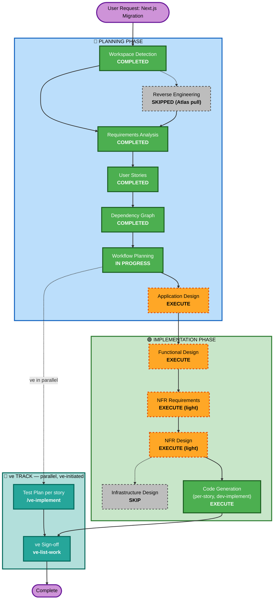

# Execution Plan

## Detailed Analysis Summary

### Transformation Scope (Brownfield)
- **Transformation Type**: Architectural transformation — decoupled React SPA + Express MVC API → unified Next.js 15 App Router monolith
- **Primary Changes**: New `src/` application (Route Handlers, Middleware, Server/Client Components, Sequelize data layer ported); `backend/` and `frontend/` left untouched this cycle
- **Related Components**: All 5 backend route groups, all 4 Sequelize models, all 6 frontend pages, ~20 UI components, 2 React Contexts — per `spec/plans/atlas-deep-dive.md` Component Inventory

### Change Impact Assessment
- **User-facing changes**: Yes — same features, but SSR instead of CSR, and session persistence via httpOnly cookie instead of localStorage (invisible to the user except fixing the XSS exposure)
- **Structural changes**: Yes — MVC (routes/controllers/models) → Next.js App Router (Route Handlers/Middleware + Server/Client Components); Axios service layer and React Router eliminated
- **Data model changes**: No — Sequelize models and PostgreSQL schema carry over unchanged (REQ-NF-03/REQ-F-18)
- **API changes**: No external contract change — same endpoints, same request/response shapes (REQ-NF-04); internal implementation changes from Express to Route Handlers
- **NFR impact**: Yes — security (httpOnly cookie auth, REQ-NF-01), performance (N+1 fix, REQ-NF-02)

### Component Relationships (Brownfield)
- **Primary Components**: `src/app/api/*` (new Route Handlers), `src/app/*` (new pages), `src/lib/*` (auth, errors, helpers), `src/lib/db/*` (Sequelize layer), `src/components/*` (ported UI)
- **Infrastructure Components**: None — no CDK/Terraform, no deployment model change this cycle (Phase 3 out of scope)
- **Shared Components**: `src/lib/db/models/index.js`, `src/lib/auth.js`, `src/lib/errors.js`, `src/lib/helpers.js` — consumed by nearly every story (see `dependency-graph.yml` `shared_files`)
- **Dependent Components**: None outside this repo — no other services call this API
- **Supporting Components**: Vitest + RTL test baseline (Story 1.9)

For each related component:
- **Sequelize models (4)**: Change Type = Minor (import path + singleton pattern only, logic unchanged); Reason = direct dependency of every API story; Priority = Critical (seed, Story 1.1)
- **Auth middleware/lib**: Change Type = Major (cookie strategy replaces localStorage+header); Reason = security requirement (REQ-NF-01); Priority = Critical (blocks 5 of 9 stories)
- **UI components (~20)**: Change Type = Minor (styling/logic preserved, JSX ported as-is); Reason = direct dependency of Stories 1.6-1.8; Priority = Important

### Risk Assessment
- **Risk Level**: Medium (per the Migration Strategy's own "Medium-Low" rating; AIRE treats it as Medium given the auth-strategy change is the highest-risk single element)
- **Rollback Complexity**: Easy — `src/` is fully additive this cycle; `backend/`/`frontend/` remain the live system untouched, so rollback is simply not merging/deploying `src/`
- **Testing Complexity**: Moderate — requires comparing old-vs-new API responses (shadow testing per the Migration Strategy) plus new Vitest/RTL coverage

## Workflow Visualization

## Phases to Execute

### 🔵 PLANNING PHASE
- [x] Workspace Detection (COMPLETED)
- [x] Reverse Engineering (SKIPPED — Atlas deep dive pulled directly from Helix)
- [x] Requirements Analysis (COMPLETED)
- [x] User Stories (COMPLETED)
- [x] Dependency Graph (COMPLETED)
- [x] Workflow Planning (this document)
- [ ] Application Design — **EXECUTE**
  - **Rationale**: New components (Route Handlers, Middleware, Server/Client Component boundaries) need explicit definition — this is exactly the "new components/services + component boundary clarification" trigger. The migration plan's Top-3 risk #3 (RSC vs Client Component boundary confusion) is best mitigated by settling this at design time, not per-story.

### 🟢 IMPLEMENTATION PHASE
- [ ] Functional Design — **EXECUTE**
  - **Rationale**: New business-logic-adjacent design decisions exist (N+1 fix via eager loading, auth cookie strategy, error-hierarchy port) that benefit from a system-level design pass before 9 stories each reinvent the pattern independently.
- [ ] NFR Requirements — **EXECUTE (light depth)**
  - **Rationale**: Security (httpOnly cookies, REQ-NF-01) and performance (N+1, REQ-NF-02) are both explicit NFRs already well-specified by the Migration Strategy — this stage formalizes them into `architecture.md` rather than re-deriving from scratch.
- [ ] NFR Design — **EXECUTE (light depth)**
  - **Rationale**: Follows directly from NFR Requirements; incorporates the cookie/middleware pattern and eager-loading pattern as reusable design decisions all API stories reference.
- [ ] Infrastructure Design — **SKIP**
  - **Rationale**: No infrastructure/deployment changes in scope this cycle (Phase 3 — production deploy, DNS, hosting — is explicitly deferred per the approved requirements). No new cloud resources, no CDK/Terraform.
- [ ] Code Generation — **EXECUTE (ALWAYS)**
  - **Rationale**: Per-story implementation via `dev-implement`, triggered by the user after the STOP CHECKPOINT.

### 🧪 ve TRACK (parallel — ve-initiated, NOT scheduled here)
- Test Plan — run per story by ve with `/ve-implement`, in parallel with development
- ve Sign-off — run by ve with `ve-list-work` on the epic branch once story PRs merge

## Package Change Sequence (Brownfield)

Not a multi-package monorepo coordination in the traditional sense (no CDK/shared-library packages), but the effective sequence per the Dependency Graph:
1. `src/` scaffold + DB layer (Story 1.1) — must land first, nothing else compiles without it
2. Auth API (Story 1.2) — blocks 5 of the remaining 7 stories
3. Profile/Follow API + Articles API (Stories 1.3, 1.4) — parallelizable once 1.2 lands
4. Favorites/Comments API (Story 1.5) — depends on 1.4
5. Frontend pages (Stories 1.6, 1.7, 1.8) — depend on their respective API stories
6. Component port + service elimination + test baseline (Story 1.9) — last, depends on all frontend stories

## Estimated Timeline

- **Total Phases**: 2 planning stages remaining (Application Design, then System-Level Design stages) + 9 stories in Code Generation
- **Estimated Duration**: Matches the Migration Strategy's own estimate for Phases 0-2: ~5 person-weeks (Phase 0: 0.5 + Phase 1: 2.0 + Phase 2: 2.5), solo-paced — AIRE's own design/gate overhead is additive but each stage is scoped to be lightweight given how detailed the source plan already is

## Success Criteria

- **Primary Goal**: A fully working Next.js 15 App Router app under `src/`, functionally equivalent to the current `backend/`+`frontend/` stack, with the N+1 query and unsafe-sync issues fixed and auth moved to httpOnly cookies
- **Key Deliverables**: `src/` app (API + pages + components), Vitest/RTL test suite, `architecture.md` + rubrics (this cycle, CI generation skipped)
- **Quality Gates**: unit tests + coverage threshold, Gherkin/behavior gates (B1/B2/B3), D1-D7 static gates, judge gates (J1/J2) — all run locally via `dev-implement` per story; CI pipeline generation and SonarQube gate skipped per user request
- **Integration Testing**: Shadow-testing old vs new API responses (per the Migration Strategy's own testing strategy) before each story is considered done
- **Operational Readiness**: N/A this cycle — no production deployment (Phase 3 out of scope)
