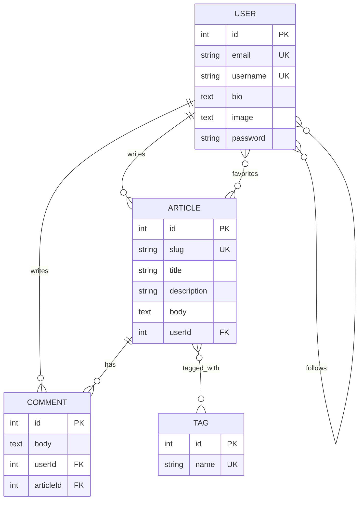

# Functional Design: conduit-helix-test Next.js Migration

**Scope**: System-level, technology-agnostic business logic for the whole migration (Phases 0-2).
Builds on the component structure from `spec/plans/application-design.md`.

---

## Domain Model

### Entities (unchanged from the current system — Sequelize models port as-is per REQ-F-03)



- **User↔Article (favorites)**: `belongsToMany` through `Favorites` join table, no timestamps.
- **User↔User (followers)**: self-referential `belongsToMany` through `Followers` join table, two aliases (`followers`, `following`), no timestamps.
- **Article↔Tag**: `belongsToMany` through `TagList` join table.
- **User→Article, User→Comment, Article→Comment**: `hasMany`, cascade delete on User→Article.

### Business Objects (response shapes — must match the Conduit/RealWorld API spec exactly, REQ-NF-04)

- **User (public)**: `{ email, username, bio, image, token }` (token only on register/login/current-user responses)
- **Profile**: `{ username, bio, image, following: boolean }`
- **Article**: `{ slug, title, description, body, tagList: string[], createdAt, updatedAt, favorited: boolean, favoritesCount: number, author: Profile }`
- **Comment**: `{ id, createdAt, updatedAt, body, author: Profile }`

---

## Business Rules & Validation

### Auth (Story 1.2) — tightened per Functional Design Q&A

| Rule | Current Behavior | New Behavior |
|---|---|---|
| Username/email/password required | ✅ checked (non-empty) | ✅ unchanged |
| Email uniqueness | ✅ checked | ✅ unchanged |
| Email format | ❌ not checked | ✅ **new**: standard email shape required |
| Password length | ❌ not checked | ✅ **new**: minimum 8 characters |
| Username format | ❌ not checked | ✅ **new**: 3-30 chars, alphanumeric + `_`/`-` |
| Username uniqueness | ❌ not checked (bug in current system) | ✅ **new**: enforced, `AlreadyTakenError` |
| Login: user not found | ✅ `NotFoundError` | ✅ unchanged |
| Login: wrong password | ✅ `ValidationError` | ✅ unchanged |
| Session mechanism | localStorage JWT | ✅ **new**: httpOnly cookie (REQ-NF-01) |

### Articles (Story 1.4)

- **Slug generation**: `slugify(title)` — unchanged algorithm from `backend/helper/helpers.js`. On update, slug is only regenerated if `title` changes (matches current behavior — verify against `backend/controllers/articles.js` at implementation time).
- **Tag association on create/update**: for each tag name in `tagList`, find-or-create a `Tag` row, then associate via the `TagList` join table — unchanged logic, only the query mechanism changes (see N+1 Fix below).
- **Authorization**: update/delete restricted to the article's own author — a non-author attempting either gets `ForbiddenError` (matches current `customErrors.js` hierarchy).
- **Feed filters**: `author` (by username), `tag` (by tag name), `favorited` (by username who favorited), `limit`/`offset` (pagination, default limit unchanged from current — verify exact default at implementation time by reading `backend/controllers/articles.js`).

### Favorites & Comments (Story 1.5)

- **Favorite toggle**: idempotent — favoriting an already-favorited article is a no-op success (matches current `belongsToMany` toggle pattern), same for unfavoriting a non-favorited one.
- **Comment authorization**: delete restricted to the comment's own author (`ForbiddenError` otherwise) — this is a NEW explicit rule; the current system's exact enforcement should be verified against `backend/controllers/comments.js` at implementation time and this design followed unless Atlas/code reveals a difference (in which case: follow the existing code, note the discrepancy, per DR-8).

### Follow (Story 1.3)

- **Self-follow**: a user cannot follow themselves — if the current backend doesn't already enforce this (verify at implementation time), add the check as a tightened rule consistent with the "tighten validation" decision, returning `ValidationError("Cannot follow yourself")`.
- **Follow toggle**: idempotent, matching the current pattern (same as Favorites).

---

## N+1 Fix — Detailed Design (REQ-F-17, REQ-NF-02)

**Current problem** (confirmed by reading `atlas-deep-dive.md` Code Smells): `allArticles`/`articlesFeed` loop over the result set calling `appendFollowers`, `appendFavorites`, `appendTagList` per article — 3 extra queries per article, so a page of N articles costs `1 + 3N` queries.

**New design**: a single query using Sequelize `include`, expressed once in the Helpers Library
(`articleIncludeOptions(viewerId)` from `application-design.md`) and reused by every Articles Service
method that returns a list or single article:

```js
// src/lib/helpers.js — conceptual shape, not final code (implementation detail decided at dev-implement)
function articleIncludeOptions(viewerId) {
  return [
    { model: Tag, as: 'tagList' },
    { model: User, as: 'author' },
    // favorited/following flags computed via a correlated subquery or a post-query map,
    // not a per-row follow-up SELECT — exact mechanism (subquery vs. attributes vs. in-memory
    // map over a single batch favorites/follows query) decided at dev-implement, whichever
    // Sequelize pattern yields the fewest total queries for the given viewerId.
  ];
}
```

**Verification method** (carried into Story 1.4's ACs): enable `logging: console.log` in the Sequelize
config during development and confirm a feed request of N articles issues a bounded, small number of
queries (target: O(1) relative to N — at most a handful of queries total, not `1 + 3N`).

---

## Error Handling (system-wide)

- The ported error hierarchy (`MyError` → `ForbiddenError`, `NotFoundError`, `UnauthorizedError`,
  `ValidationError`, `FieldRequiredError`, `AlreadyTakenError`) is the ONLY error vocabulary used by
  every service — no new ad-hoc error types introduced.
- Every Route Handler catches errors from its service call and maps them to the Conduit spec's
  `{ errors: { body: [...] } }` response shape with the error class's associated HTTP status code
  (unchanged mapping from the current `errorHandler.js` middleware).

---

## Frontend Functional Design (component-level business logic)

- **Session state**: no client-side auth state store (no `AuthContext` equivalent) — every page that
  needs to know "is there a logged-in user" reads it via the server-verified cookie in a Server
  Component, or via a lightweight `useSession()`-style hook backed by a `/api/user` call in Client
  Components that need it reactively (e.g. Navbar showing login vs. profile link).
- **Feed state**: no `FeedContext` equivalent — feed selection (global/personal/tag) is a URL search
  param (`?feed=personal` or `?tag=x`), read server-side by the Home page Server Component; switching
  feeds is a `<Link>` navigation, not client state mutation.
- **Form validation**: Client Components (Login, Register, Settings, Editor) perform light client-side
  validation (required fields) for UX responsiveness, but the tightened rules above are enforced
  authoritatively server-side in the corresponding service — client-side validation is a UX nicety,
  never the source of truth.

---

## Design Completeness Check

- Every REQ-ID touching business logic (REQ-F-10 through REQ-F-18, REQ-F-20 through REQ-F-30) has a
  corresponding rule or explicit "unchanged from current system" note above.
- The N+1 fix (REQ-F-17/REQ-NF-02) has a concrete, verifiable design, not just a restated requirement.
- Every business rule that changes from current behavior is explicitly flagged as new/tightened — no
  silent behavior change.
