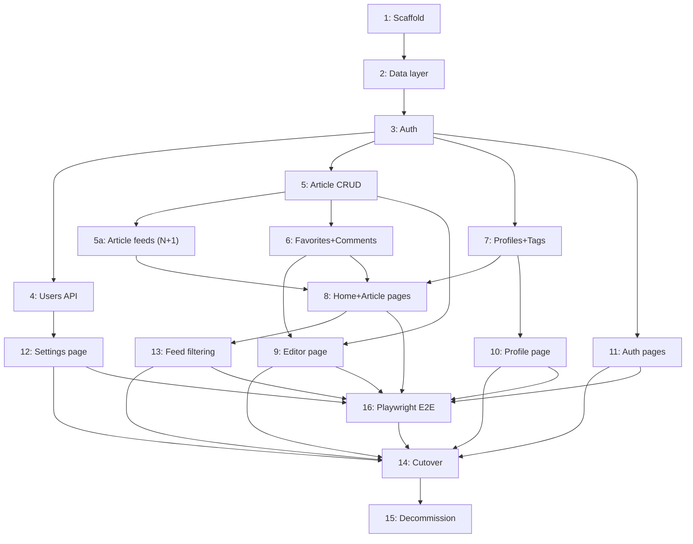

# aire State Tracking

## Project Information
- **Project Type**: Brownfield
- **Start Date**: 2026-09-07T10:11:36Z
- **Current Stage**: Code Generation — Story 1 In Development

## Workspace State
- **Existing Code**: Yes
- **Programming Languages**: JavaScript (ES Modules) — React 19 (frontend), Express.js 5 (backend)
- **Build System**: npm workspaces monorepo (Vite for frontend, plain Node.js for backend)
- **Project Structure**: Decoupled full-stack monorepo (RealWorld Conduit reference app)
- **Workspace Root**: /Users/revanta.biswas/Desktop/conduit-helix-test
- **Reverse Engineering Needed**: No — satisfied by Atlas deep dive (see below)

## Code Location Rules
- **Application Code**: `backend/` and `frontend/` (see `## Code Root` below)
- **Documentation**: spec/ only
- **Structure patterns**: See code-generation.md Critical Rules

## Code Root
- **Type**: monorepo
- **Path(s)**: backend, frontend (declared in root `package.json` `workspaces`)
- **Recorded**: 2026-09-07T10:11:36Z
- **Note**: existing tree left in place; new application code for this cycle follows the migration plan's target layout (`conduit-next/`), created fresh under this monorepo

## Existing-System Context
- **Workspace type**: brownfield | migration
- **Helix MCP**: connected
- **Source**: atlas
- **Components in scope**: whole estate (backend routes/controllers/models, frontend pages/components/services/contexts)
- **Atlas deep dive doc**: spec/plans/atlas-deep-dive.md
- **Modernization/Migration plan**: spec/plans/modernization-plan.md (Atlas document_id 3638, "Migration Strategy: conduit-helix-test")
- **Recorded**: 2026-09-07T10:11:36Z

## Helix MCP Binding
- **Server**: helix
- **Docs tool(s)**: get_solution_document_tool, list_solution_documents_tool — fetches solution documents (deep dive, migration strategy) by ID
- **Graph/Search tool(s)**: document_chatbot_query, codebase_agent_query, codebase_cypher_query, graph_change_impact — targeted inline answers on demand
- **Estate / workspace id**: solution_id 960 (conduit-helix-test)
- **Resolved**: 2026-09-07T10:11:36Z

## Tracker
- Type: GITHUB
- Parent Epic: Milestone #1 "Epic: Next.js Modernization"
- Epic URL: https://github.com/revanta-biswas/conduit-helix-test/milestone/1
- Project Key / Repo / Org: revanta-biswas/conduit-helix-test

## Branching
- Base Branch: main
- Epic Branch: epic/nextjs-modernization (pushed, commit 2a707d528684140e20443a39a34ee87f206d03f5)
- Epic PR: (not raised — raised manually at cycle end via pr-generator)

## Context Project
- **Existing Knowledge**: No
- **Existing Knowledge Path(s)**: —
- **New References**: No
- **New Reference Path(s)**: —

## team_size
- 2 (fixed default, not asked)

## story_creation_mode
- all-at-once (fixed default, not asked)

## Story Tracker
| Story | Title | Requires | Tracker ID | Status | PR | Merged | Start | End | Recorded |
|-------|-------|----------|------------|--------|----|--------|-------|-----|----------|
| 1 | Next.js application scaffold | none | #1 | 🔵 In Development | https://github.com/revanta-biswas/conduit-helix-test/pull/18 | no | 2026-09-07 | | 2026-09-08T01:55:00Z |
| 2 | Sequelize data layer port | 1 | #2 | 🟢 Ready for Development | — | — | | | 2026-09-07T10:42:34Z |
| 3 | Cookie-based authentication | 2 | #3 | 🟢 Ready for Development | — | — | | | 2026-09-07T10:42:34Z |
| 4 | Users & current-user API | 3 | #4 | 🟢 Ready for Development | — | — | | | 2026-09-07T10:42:34Z |
| 5 | Article CRUD API | 3 | #5 | 🟢 Ready for Development | — | — | | | 2026-09-07T10:42:34Z |
| 5a | Article feeds API (N+1 fix) | 5 | #6 | 🟢 Ready for Development | — | — | | | 2026-09-07T10:42:34Z |
| 6 | Favorites & comments API | 5 | #7 | 🟢 Ready for Development | — | — | | | 2026-09-07T10:42:34Z |
| 7 | Profiles, follow, and tags API | 3 | #8 | 🟢 Ready for Development | — | — | | | 2026-09-07T10:42:34Z |
| 8 | Home and Article-view pages | 5a, 6, 7 | #9 | 🟢 Ready for Development | — | — | | | 2026-09-07T10:42:34Z |
| 9 | Article editor page | 5, 6 | #10 | 🟢 Ready for Development | — | — | | | 2026-09-07T10:42:34Z |
| 10 | Profile page | 7 | #11 | 🟢 Ready for Development | — | — | | | 2026-09-07T10:42:34Z |
| 11 | Auth pages (Login / SignUp) | 3 | #12 | 🟢 Ready for Development | — | — | | | 2026-09-07T10:42:34Z |
| 12 | Settings page | 4 | #13 | 🟢 Ready for Development | — | — | | | 2026-09-07T10:42:34Z |
| 13 | Feed filtering re-architecture | 8 | #14 | 🟢 Ready for Development | — | — | | | 2026-09-07T10:42:34Z |
| 14 | Production cutover to Fly.io | 9, 10, 11, 12, 13, 16 | #15 | 🟢 Ready for Development | — | — | | | 2026-09-07T10:42:34Z |
| 15 | Decommission old stack | 14 | #16 | 🟢 Ready for Development | — | — | | | 2026-09-07T10:42:34Z |
| 16 | Playwright E2E coverage | 8, 9, 10, 11, 12, 13 | #17 | 🟢 Ready for Development | — | — | | | 2026-09-07T10:42:34Z |

## Dependency Graph

**Inferred edges & justification**:
- 2 requires 1 — needs `conduit-next/` to exist at all (R1 seed story)
- 3 requires 2 — auth Route Handlers need the Sequelize `User` model at compile/run time (R2)
- 4, 5, 7, 11 require 3 — every authenticated API/page needs the auth Middleware + cookie contract to exist (R2)
- 5a, 6, 9 require 5 — same route file (`app/api/articles/[...slug]/route.ts`), sequenced to avoid unmergeable conflicts (R1); 9 also requires 6 since the editor calls favorite/comment-adjacent behavior indirectly through the same file
- 8 requires 5a, 6, 7 — Home/Article pages read feeds (5a), display favorite/comment counts (6), and show author profile links (7) at render time (R2)
- 10 requires 7 — profile page reads the Profiles API directly (R2)
- 12 requires 4 — settings page submits to the Users API (R2)
- 13 requires 8 — feed filtering re-architects the Home page built in 8 (R2)
- 14 (cutover) requires 9, 10, 11, 12, 13, 16 — every page story and the E2E suite must be green before a production cutover (R4 is deliberately NOT applied here — this is a genuine gate, not narrative ordering)
- 16 (Playwright) requires 8, 9, 10, 11, 12, 13 — E2E tests exercise all page stories' real UI (R2, not mocked — R3 does not apply since this IS the integration-verifying story)
- 15 (decommission) requires 14 — must not delete the old stack before the new one is confirmed live

**Ready-stories summary**: Story 1 has no prerequisites — startable immediately. Every other story is currently blocked, since this is a linear-foundation migration (scaffold -> data -> auth are hard sequential prerequisites). Once Story 3 (Auth) merges, **4 stories become simultaneously startable** (4, 5, 7, 11) — satisfying team_size=2 parallelism from that point on.

team_size: 2 (target: >= 2 independent stories available at a time — met from Story 3 onward)

## Stage Progress
- Workspace Detection: Complete
- Reverse Engineering: Skipped (satisfied by Atlas deep dive)
- Requirements Analysis: Complete (approved 2026-09-07T10:11:36Z)
- User Stories: Complete (GATE 1 approved, 17 stories pushed to GitHub issues #1-17, linked to Milestone #1)
- Dependency Graph: Complete (auto-approved, spec/plans/dependency-graph.yml written)
- Workflow Planning: Complete (auto-approved, spec/plans/executions.md written — Application Design, Functional Design, NFR Requirements, NFR Design, Infrastructure Design all set to EXECUTE)
- Application Design: Complete (approved 2026-09-07T11:30:58Z)
- Functional Design: Complete (approved 2026-09-07T11:30:58Z)
- NFR Requirements: Complete (approved 2026-09-07T11:30:58Z)
- NFR Design: Complete (approved 2026-09-07T11:30:58Z)
- Infrastructure Design: Complete (approved 2026-09-07T11:30:58Z)
- STOP CHECKPOINT: Complete — 2026-09-07T12:29:07Z — Design complete — awaiting dev-implement
- Code Generation: Not started (blocked on `dev-implement`)

## Requirements Coverage — Post-Design Verification
Requirements coverage verified post-design: 22/22 REQ-IDs — 2026-09-07T11:30:58Z
No story AC contradicted by any design artifact; Infrastructure Design's "existing external PostgreSQL, no new provisioning" confirms Story 2 AC-5 and Story 14 AC-3 exactly. No reconciliations needed.

## STOP CHECKPOINT — Architecture, Rubrics, CI Pipeline
- **spec/behavior.feature**: written 2026-09-07T12:29:07Z — 5 cross-story scenarios tagged @REQ-*, per common/behavior-spec.md Section 3.
- **spec/plans/architecture.md**: version 1.0.0, generated 2026-09-07T11:48:03Z. Consolidates application-design.md, functional-design.md, nfr.md, infrastructure-design.md, atlas-deep-dive.md. Section 10 Verifiable Constraints: 6 constraints (ARCH-01..06), weights sum 1.0.
- **tests/.evals/rubrics/architecture-rubric.json**: rubricVersion 1.0.0, 6 criteria, derived 1:1 from architecture.md Section 10.
- **tests/.evals/rubrics/security-rubric.json**: rubricVersion 1.0.0, 8 OWASP Top 10:2025 criteria (A01,A07,A05,A04,A06,A02,A03,A09), weights sum 1.0.
- **tests/.evals/config.json**: created (did not exist before). `ci.manifestState: "resolved"`, 2 roots (backend, frontend) — real package.json scripts/commands read from the repo. `conduit-next/` will join as a 3rd root via its own `ci-manifest.d/` fragment once Story 1 lands.
- **.github/workflows/agentic-eval-pipeline.yml**: generated from `templates/ci/agentic-eval-pipeline.yml.template`, slots substituted (BASE_BRANCH=main, PR_BRANCH_FILTERS=epic/bug/enh/ci/story/ve, BEHAVIOR_IMAGE_TAG=aire-behavior:ci, CLAUDE_CODE_VERSION=2.1.263, SONAR_STEPS=skipped/commented per the setup gate answer below).
- **tests/.evals/scripts/**: copied byte-for-byte from templates/ci/ (lib-manifest, read-manifest, ci-manifest-runner, run-static-evals, run-evals, auto-fix-agent, validate-pipeline, smoke-test-epic, resolve-eval-key). `run-static-evals.sh`'s STACK-RESOLVED D-GATES region filled in for D1/D4/D5/D6 (Node/JS, two roots) + D2 recorded N/A (no TypeScript). `run-evals.sh` and `auto-fix-agent.sh`'s CLAUDE_JUDGE_INVOCATION / CLAUDE_REPAIR_INVOCATION markers filled in with flags resolved from `claude --help` (CLI v2.1.263).
- **tests/.evals/scripts/gate-helpers/**: 3 new wrapper scripts (eslint-tsv.sh, npm-audit-tsv.sh, license-checker-tsv.sh) — real tool invocations transformed to the `rule\tfile\tmessage` TSV `delta_diff` expects.
- **tests/.evals/behavior/**: Containerfile (Node 20 base + @cucumber/cucumber) and run.sh (copied, STACK-RESOLVED BEHAVIOUR RUNNER region filled with a cucumber-js invocation, NODE_PATH pointed at frontend/node_modules per behavior-spec.md Section 4.1a).
- **backend/eslint.config.js, frontend/eslint.config.js**: created (bootstrap, eval-framework.md Section 2.3) — recommended preset + complexity rule at maxCyclomaticComplexity (12).
- **SonarQube setup gate (Section 4.1.2)**: originally defaulted to **skip** on 2026-09-07 (never a genuine user decision — see audit.md). The user has now answered **proceed** on 2026-09-08: confirmed `SONAR_TOKEN`, `SONAR_HOST_URL`, and `CLAUDE_CODE_OAUTH_TOKEN` are present as GitHub repo secrets (verified via `gh secret list`), and set `sonar.organization=revanta-biswas` in `sonar-project.properties` (STATUS marked ACTIVE). Per Section 4.1.3's `proceed` handling: the two SonarQube steps ("SonarQube scan" id `sonar`, "SonarQube quality gate" id `sonarqg`) are now active in `.github/workflows/agentic-eval-pipeline.yml`, copied verbatim from `ci-pipeline-generation.md` Section 4.1.1b (both guarded by `if: steps.sonarscope.outputs.skip != 'true'`); `sonarqube.enabled: true` in `tests/.evals/config.json` and `sonarqube` appended to `ci.gates`.
- **Validation**: `tests/.evals/scripts/validate-pipeline.sh` run against `git merge-base origin/main HEAD`. V1/V3/V4/V7/V7b/V9(static)/V10/V11/V12/V13/V14/V15/V16/V19/V22/V24/V26/V27/V28/V29/V30/V31/V35 all PASS. V2 (actionlint) not run — tool unavailable on this machine. Three FAILs (V8 `|| true`, V9 run-evals.sh hardcoded-literal heuristic, V20 "yet" phrase) are confirmed false positives against byte-identical, unmodified `templates/ci/` source text (diffed to confirm) — not generation defects. V17/V21/V23 not mechanically verified (need live judge credentials / true clean-room container / fault injection respectively) — noted, not run.
- **run-static-evals.sh dry run**: executed for real against `EVAL_KEY=dry-run-stopcheckpoint`. D3(semgrep)=PASS, D7(gitleaks)=FAIL — 2 pre-existing findings in `aire-workflow/templates/ci/agentic-eval-pipeline.yml.template` (curl `-u "${SONAR_TOKEN}:"` basic-auth syntax, false positive, not a real secret), D1/D4/D5/D6=N/A (diff-scoped — this cycle has not yet touched backend/frontend), D2=N/A (no TypeScript). Gate wrappers (eslint/npm-audit/license-checker) verified individually against both roots with real findings/clean results before being wired in.
- **smoke-test-epic.sh**: NOT run — requires `CLAUDE_CODE_OAUTH_TOKEN`/`ANTHROPIC_API_KEY` as a GitHub repo secret (none configured yet, expected on a fresh repo) and opens a real scratch PR via `gh`. Deferred to the user; see STOP CHECKPOINT report.
- **Recorded**: 2026-09-07T12:29:07Z
