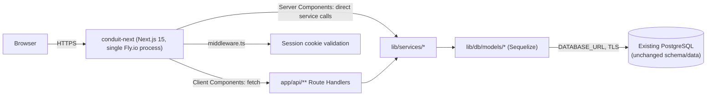

# Architecture — conduit-helix-test (Next.js Modernization)

> **Version**: 1.0.0 · **Generated**: 2026-09-07T11:48:03Z · **AIRE**: v1.0
> **Derived from**: spec/plans/atlas-deep-dive.md, spec/plans/modernization-plan.md,
> spec/plans/requirements.md, spec/plans/application-design.md, spec/plans/functional-design.md,
> spec/plans/nfr.md, spec/plans/infrastructure-design.md, spec/plans/stories.md,
> spec/plans/dependency-graph.yml
> **Existing-system baseline**: Atlas via Helix MCP, solution_id 960 (conduit-helix-test),
> document_id 3627 "System Exploration: conduit-helix-test" (deep dive) and document_id 3638
> "Migration Strategy: conduit-helix-test" (modernization plan)

---

## 1. System Context

`conduit-helix-test` is a RealWorld Conduit reference implementation — a Medium-style blogging
platform (articles, comments, profiles, tag-based feeds, follow/favorite social features). The
**existing system** is a decoupled full-stack monorepo: a React 19 + Vite SPA (`frontend/`) calling
a REST API served by Express.js 5 + Sequelize 6 (`backend/`), backed by PostgreSQL. This epic
migrates that system to a **unified Next.js 15 App Router monolith** (`conduit-next/`) that serves
both pages and API Route Handlers from one process, while leaving the database schema and data
untouched (REQ-NF-02).

The old `backend/`/`frontend/` packages remain live and untouched through Stories 1-13 (rollback
safety, REQ-NF-05) and are removed only in Story 15, after the Story 14 cutover.

---

## 2. Component Inventory

| Component | Responsibility | Status | Source |
|---|---|---|---|
| `conduit-next/` (npm workspace member) | New unified Next.js app | new | application-design.md, Story 1 |
| `lib/db/models/{Article,User,Tag,Comment}.js` | Sequelize Active Record models + associations | ported (unmodified schema) | atlas-deep-dive.md, application-design.md, Story 2 |
| `lib/db/index.js` | Connection singleton, hot-reload-safe | new | application-design.md, Story 2 |
| `lib/auth.js` | JWT sign/verify, httpOnly cookie helpers | new (replaces client-side localStorage) | functional-design.md, Story 3 |
| `lib/errors.js` | Typed error classes + RealWorld error-shape serialization | ported from `customErrors.js` | application-design.md, Story 3 |
| `lib/helpers.js` | Ported utility functions | ported from `backend/helper/helpers.js` | application-design.md, Story 3 |
| `middleware.ts` | Deny-by-default route protection | new | application-design.md, nfr.md, Story 3 |
| `lib/services/{user,article,favorite,comment,profile,tag}Service.js` | Business logic per resource | new (business rules inherited, unchanged) | application-design.md, functional-design.md, Stories 3-7 |
| `app/api/users/route.ts`, `app/api/user/route.ts` | Register/login, current-user Route Handlers | ported | application-design.md, Stories 3-4 |
| `app/api/articles/[...slug]/route.ts` | Article CRUD, feeds, favorites, comments | ported, N+1 fixed | application-design.md, Stories 5, 5a, 6 |
| `app/api/profiles/[username]/route.ts`, `app/api/tags/route.ts` | Profiles, follow, tags | ported | application-design.md, Story 7 |
| `app/(home)/page.tsx`, `app/article/[slug]/page.tsx` | Home + article view (Server Components) | ported | application-design.md, Stories 8, 13 |
| `app/editor/**`, `app/profile/[username]/page.tsx`, `app/login`, `app/register`, `app/settings` | Remaining pages | ported | application-design.md, Stories 9-12 |
| `components/**` (~20 components) | UI components | ported, CSS unchanged (REQ-NF-06) | application-design.md, Stories 8-12 |
| Fly.io app (`shared-cpu-1x`) | Single deployment unit, both pages + API | new | infrastructure-design.md, Story 14 |
| `backend/`, `frontend/` (existing packages) | Old MVC backend + SPA frontend | removed at cutover | atlas-deep-dive.md, Story 15 |

---

## 3. Layering and Boundaries

- **Route Handlers are thin**: parse request → call the matching `lib/services/*` function → map
  result/error via `lib/errors.js` → return `NextResponse.json(...)`. No business logic in a Route
  Handler file.
- **Server Components call `lib/services/*` directly** (in-process, no HTTP round-trip) — e.g. the
  home page calls `articleService.listFeed(...)` directly rather than fetching `/api/articles`.
- **Client Components never import `lib/services/*` or `lib/db/*` directly** — server-only modules;
  they call Route Handlers via `fetch`/Server Actions.
- **All database access goes through `lib/services/*`**, which are the only modules that import
  `lib/db/models/*`. No raw Sequelize call from a Route Handler, page, or component.
- **`lib/db/index.js` is the single connection** every service imports — no service or Route Handler
  creates its own Sequelize instance.
- **`middleware.ts` runs before every protected Route Handler and protected page** — it is the one
  place session validation happens; individual services/handlers trust `middleware.ts`'s attached
  `userId`, they do not re-validate the JWT themselves (this is what ARCH-03 below enforces).

---

## 4. Data Architecture

- **Store**: the existing external PostgreSQL instance the current `backend/` already connects to.
  No new database is provisioned; no schema migration runs as part of this epic (REQ-NF-02).
- **Schema source of truth**: the existing Sequelize CLI migrations under (currently) `backend/`
  remain authoritative. `sequelize.sync({ alter: true })` — the production risk flagged in the Atlas
  deep dive — is explicitly excluded from the ported code path (Story 2 AC-3).
- **Models**: `Article`, `User`, `Tag`, `Comment`, ported verbatim with all existing associations
  (`belongsToMany` for Favorites, Followers, TagList via join tables) — no new entities.
- **Transaction boundaries**: single-statement Sequelize operations per service method (existing
  behavior, unchanged) — no multi-step money/state operation exists in this domain, so no explicit
  transaction wrapping is introduced beyond what Sequelize already does per query.
- **Query pattern change (not a data-shape change)**: the N+1 `appendFollowers`/`appendFavorites`/
  `appendTagList` per-article loop is replaced with Sequelize `include` eager loading in
  `articleService.listFeed` — at most 2-3 queries per feed request (REQ-NF-07, functional-design.md
  Section 3.1).

---

## 5. API and Integration Contracts

- **Protocol**: HTTP/JSON, Next.js Route Handlers under `app/api/**`, mirroring the existing Conduit
  REST API paths (`/api/users`, `/api/user`, `/api/articles/...`, `/api/profiles/...`, `/api/tags`).
- **Response shape**: every ported endpoint MUST match the RealWorld API spec exactly (REQ-NF-01),
  validated against the existing Postman/HTTPie collection referenced in the migration plan.
- **Error model**: uniform RealWorld shape `{ errors: { body: [...] } }` — `422` validation, `401`
  auth failure, `403` authorization failure, `404` not found — produced by `lib/errors.js`
  `toErrorResponse`.
- **Auth model**: session-cookie-based (httpOnly, `Secure`, `SameSite`), never a bearer token in a
  JSON body or client-readable storage — this is the one contract change from the existing system
  (which returned the JWT in the response body for `localStorage`).
- **Versioning**: none introduced — this migration preserves the existing unversioned API surface.

---

## 6. Cross-Cutting Decisions

- **AuthN**: JWT signed server-side, stored in an httpOnly, `Secure`, `SameSite` cookie, 7-day
  expiration (functional-design.md). Validated on every request to a protected route by
  `middleware.ts`, pinned signature algorithm — `alg: none` is never accepted (SECURITY-08).
- **AuthZ**: object-level authorization enforced in the service layer — an article/comment may only
  be updated/deleted by its author (existing rule, restated as Story 5/6 ACs).
- **Error handling**: `lib/errors.js` typed error classes (`ValidationError`, `AuthError`,
  `NotFoundError`, `ForbiddenError`) map to fixed HTTP statuses; a Server Component missing a
  resource calls Next.js `notFound()` rather than rendering an inline message.
- **Logging**: structured server-side logging in Route Handlers/services; no secrets or PII in log
  output (SECURITY-03 — this is ARCH-04 below).
- **Configuration and secrets**: `DATABASE_URL` and the JWT signing secret are set via
  `fly secrets set` in production; a gitignored `.env.local` for local development only, never
  committed and never used in production.
- **Caching**: `cache: 'no-store'` uniformly on every Server Component data call — no caching layer
  is introduced (NFR Design decision, avoids stale-data risk at this scale).
- **Concurrency**: no new concurrency pattern — Sequelize's own connection pool handles this;
  identical to the existing system's behavior.

---

## 7. Non-Functional Targets

| Concern | Target | Source | How it is verified |
|---|---|---|---|
| N+1 query elimination | At most 2-3 Sequelize queries per feed request | REQ-NF-07, functional-design.md 3.1 | Query logging during Story 5a, asserted in that story's tests |
| API contract parity | Every ported endpoint's JSON shape matches the RealWorld spec exactly | REQ-NF-01 | RealWorld Postman/HTTPie collection run per relevant story |
| Test coverage | New/ported `conduit-next/` code meets `unitTestCoverageMin` (tests/.evals/config.json) | REQ-NF-04 | D-gate coverage delta, every story |
| Session cookie hardening | `Secure` + `HttpOnly` + `SameSite`, 7-day expiry, pinned JWT algorithm | REQ-NF-03, SECURITY-08, SECURITY-12 | Story 3 AC-1/AC-2, security rubric SEC-* |
| Rollback safety per phase | Working rollback path at every phase (delete conduit-next/ / old stack live / git branch + pg_dump) | REQ-NF-05 | infrastructure-design.md, Story 14 AC (pg_dump before cutover) |
| Performance (qualitative) | Dev response times < 500ms; no formal Core Web Vitals budget | nfr.md | Manual sanity check, no automated gate introduced |

---

## 8. Infrastructure and Deployment

- **Runtime topology**: one Fly.io app (`shared-cpu-1x`, 256MB-1GB RAM), running `next build && next
  start` — a single process serving both pages and API Route Handlers (infrastructure-design.md).
- **Environments**: local development only prior to Story 14; production is the single Fly.io
  deployment created at cutover.
- **Deployment unit**: `conduit-next/`, deployed as a whole on each release; no separate
  frontend/backend deploy artifacts (this is the architectural point of the migration).
- **External dependencies**: the existing external PostgreSQL instance (unchanged, in-place,
  REQ-NF-02) — no new datastore, queue, cache, or third-party API is introduced.
- **Scaling model**: none beyond Fly.io's default auto-stop/auto-start — matches the confirmed
  solo/demo scale; no auto-scaling or multi-region requirement.
- **Monitoring**: Fly.io's built-in log stream + metrics dashboard; no external error-tracking
  service added (NFR Design decision).

---

## 9. Delta from the Existing System

| Area | Before (Atlas) | After | Reason |
|---|---|---|---|
| Process topology | 2 processes: React SPA (Vite, port 3000) + Express API (port 3001) | 1 process: Next.js App Router (`conduit-next/`) | REQ-F-01, REQ-F-13 — unify deployment |
| Auth storage | JWT in `localStorage`, read by `AuthContext` | JWT in httpOnly cookie, validated by `middleware.ts` | REQ-F-03, REQ-NF-03 — eliminate XSS exposure of the session token |
| Data fetching (frontend) | 14 Axios service files calling the Express API over HTTP | Server Components call `lib/services/*` in-process; Client Components `fetch` Route Handlers | REQ-F-11 — eliminate the network hop for server-rendered data |
| Feed query pattern | `appendFollowers`/`appendFavorites`/`appendTagList` per-article loop (N+1) | Sequelize `include` eager loading, 2-3 queries total | REQ-F-05, REQ-NF-07 — Atlas-flagged performance bottleneck, fixed during the port, not deferred |
| State management | `AuthContext` + `FeedContext` (React Context API) | Server-side session resolution (middleware) + URL search params (feed filtering) | REQ-F-12 — App Router idioms replace client-side global state |
| Schema / data | PostgreSQL, existing schema, `sequelize.sync({ alter: true })` runs on every boot (flagged risk) | Same PostgreSQL instance, same schema/data, `sync({ alter: true })` removed from the ported path | REQ-NF-02 (no migration) + Story 2 AC-3 (Atlas-flagged risk retired) |
| Deployment | Not previously deployed to a fixed target beyond a demo link | Single Fly.io app, `shared-cpu-1x` | REQ-F-13, clarifying answer Q5 |
| Styling | Existing CSS approach | Unchanged — ported as-is | REQ-NF-06 (explicit non-goal: no Tailwind adoption) |
| Language | Plain JavaScript (ES Modules) | Unchanged — plain JavaScript, no TypeScript | REQ-NF-06 (explicit non-goal: no TypeScript adoption) |

---

## 10. Verifiable Constraints

Weights sum to 1.0. Every constraint is checkable against a diff.

### ARCH-01 — No direct database access outside the service layer
- **Constraint**: All Sequelize model access (`lib/db/models/*`) happens only from within
  `lib/services/*`. Route Handlers, pages, and components never import a model directly.
- **Verifiable as**: Any changed file under `conduit-next/app/**` or `conduit-next/components/**`
  that imports from `lib/db/models` or calls a Sequelize model method directly scores 0.
- **Weight**: 0.25
- **Source**: spec/plans/application-design.md (Section 3 — Services Orchestration)

### ARCH-02 — Client Components never import server-only modules
- **Constraint**: A file marked `"use client"` (or a component consumed only by one) never imports
  `lib/services/*`, `lib/db/*`, or `lib/auth.js` directly — it calls a Route Handler via `fetch`/a
  Server Action instead.
- **Verifiable as**: Any changed Client Component file containing an import from `lib/services`,
  `lib/db`, or `lib/auth` scores 0.
- **Weight**: 0.20
- **Source**: spec/plans/application-design.md (Section 3), spec/plans/functional-design.md (Section 5)

### ARCH-03 — Session validation happens only in middleware.ts
- **Constraint**: JWT verification (`verifySession`/equivalent) is called only from
  `conduit-next/middleware.ts`; downstream services and Route Handlers trust the `userId` middleware
  attaches rather than re-parsing or re-verifying the session cookie themselves.
- **Verifiable as**: Any changed Route Handler or service file that reads the session cookie or calls
  a JWT-verify function directly (outside `middleware.ts` or `lib/auth.js`'s own exported helper)
  scores 0.
- **Weight**: 0.20
- **Source**: spec/plans/nfr.md (NFR Design — `middleware.ts` deny-by-default auth gate),
  spec/plans/application-design.md (Section 3)

### ARCH-04 — No secrets, tokens, or PII in log output
- **Constraint**: Passwords, JWTs, session cookies, and full user-record dumps never reach a log
  statement.
- **Verifiable as**: Any changed log call (`console.*`, a logging helper) that passes a password
  field, a raw JWT/cookie value, or a full request/user object without redaction scores 0.
- **Weight**: 0.15
- **Source**: spec/plans/nfr.md (Security — SECURITY-03)

### ARCH-05 — No `sequelize.sync({ alter: true })` in the ported code path
- **Constraint**: The ported data layer never calls `sequelize.sync({ alter: true })` at startup or
  anywhere in `lib/db/*`; only `sequelize.authenticate()` is used to verify the connection.
- **Verifiable as**: Any changed file under `lib/db/**` containing `sync(` with an `alter` option (or
  a bare `sync()` used as a migration mechanism) scores 0.
- **Weight**: 0.10
- **Source**: spec/plans/stories.md (Story 2, AC-3), spec/plans/atlas-deep-dive.md (flagged production risk)

### ARCH-06 — Mass-assignment protection via explicit field allowlists
- **Constraint**: Every Route Handler that accepts a request body for create/update binds only an
  explicit allowlist of fields to the underlying model/service call — never a raw spread of the
  parsed body.
- **Verifiable as**: Any changed Route Handler under `app/api/**` that passes `req.body` (or an
  equivalent parsed-body object) directly into a service call or model `create`/`update` without an
  intervening allowlist/DTO scores 0.
- **Weight**: 0.10
- **Source**: spec/plans/stories.md (Story 4 AC-4, Story 5 AC-4 — SECURITY-08 mass-assignment protection)

**Total weight**: 0.25 + 0.20 + 0.20 + 0.15 + 0.10 + 0.10 = **1.00**

---

## 11. Explicitly Out of Scope

- **TypeScript adoption** — explicit non-goal (REQ-NF-06, clarifying answer Q2). `middleware.ts` uses
  the `.ts` extension only because that is the one filename Next.js's own middleware convention
  requires; its contents remain plain JavaScript syntax, no type annotations.
- **Prisma or any ORM swap** — explicit non-goal (REQ-NF-06, clarifying answer Q3). Sequelize only.
- **Tailwind CSS or any styling-framework adoption** — explicit non-goal (REQ-NF-06, clarifying
  answer Q4). Existing CSS approach ported as-is.
- **Data migration or schema transformation** — explicitly forbidden (REQ-NF-02). Same PostgreSQL
  instance, same schema, same data.
- **New caching layer, queue, or third-party API integration** — none exists in the current system
  (Atlas deep dive) and none is introduced.
- **Multi-region or auto-scaling infrastructure** — solo/demo scale confirmed; out of scope for this
  migration (infrastructure-design.md).
- **Playwright E2E coverage of the old SPA** — explicit non-goal (clarifying answer Q6); only the new
  Next.js pages get E2E coverage (REQ-F-15, Story 16).
- **Rate limiting (SECURITY-11)** — a pre-existing gap in the current system, not introduced or
  remediated by this migration; explicitly flagged as inherited, out of scope for these 17 stories.
