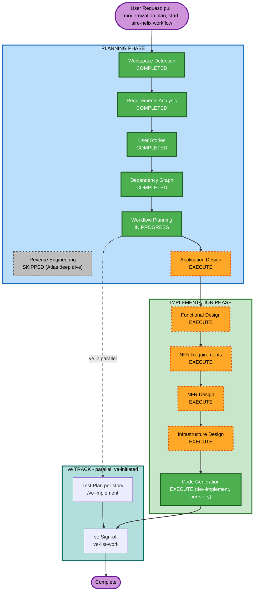

# Execution Plan — Next.js Modernization

## Detailed Analysis Summary

### Transformation Scope (Brownfield)
- **Transformation Type**: Architectural transformation — decoupled React SPA + Express.js MVC API monorepo unified into a single Next.js 15 App Router monolith.
- **Primary Changes**: New `conduit-next/` package; auth model change (localStorage JWT to httpOnly cookie + Middleware); all 5 API resource groups re-implemented as Route Handlers; all 6 pages re-implemented as Server/Client Components; N+1 query fix; deployment target set to Fly.io; old `backend/`/`frontend/` decommissioned.
- **Related Components**: All 4 Sequelize models, all 6 backend route/controller groups, all ~20 frontend components, both React Contexts.

### Change Impact Assessment
- **User-facing changes**: Yes — auth session mechanism changes (transparent to the user), SSR improves perceived load time, no functional/UX change to article/social features.
- **Structural changes**: Yes — the split-server architecture is eliminated; MVC layering is replaced by Route Handlers + Server/Client Components.
- **Data model changes**: No — REQ-NF-02 mandates in-place DB retention; Sequelize models port verbatim.
- **API changes**: No (contract) — REQ-NF-01 mandates response-shape parity with the RealWorld spec; the transport mechanism (Express routes to Next.js Route Handlers) changes but the surface does not.
- **NFR impact**: Yes — security (auth hardening, SECURITY-08/12), performance (N+1 fix, REQ-NF-07).

### Component Relationships (Brownfield)
- **Primary Component**: New `conduit-next/` package (all 17 stories touch it)
- **Infrastructure Components**: None (no CDK/Terraform in this repo) — deployment config for Fly.io only
- **Shared Components**: Sequelize models (Story 2), auth Middleware (Story 3) — every downstream story depends on these
- **Dependent Components**: All 5 API-layer stories depend on auth; all 6 page stories depend on their respective API stories
- **Supporting Components**: Playwright E2E (Story 16) depends on the page stories it exercises

### Risk Assessment
- **Risk Level**: Medium-Low (matches the migration plan's own assessment) — small codebase (~3,500 LOC), clean existing 1:1 mapping to Next.js equivalents, but the auth mechanism change and RSC/Client Component boundary are genuine conceptual shifts.
- **Rollback Complexity**: Easy per-phase (delete `conduit-next/`, or the old stack remains live) until cutover; Moderate at cutover (git branch + `pg_dump` restore, <5 min per the plan).
- **Testing Complexity**: Moderate — shadow testing against the live old Express server, RealWorld Postman collection, plus this framework's own unit/behavior/eval gates per story.

## Workflow Visualization



### Text Alternative (always included per content-validation.md)

```
PLANNING PHASE:
- Workspace Detection (COMPLETED)
- Reverse Engineering (SKIPPED — satisfied by Atlas deep dive)
- Requirements Analysis (COMPLETED)
- User Stories (COMPLETED — 17 stories, GATE 1 approved, pushed to GitHub)
- Dependency Graph (COMPLETED — auto-approved)
- Workflow Planning (IN PROGRESS)
- Application Design (EXECUTE)

IMPLEMENTATION PHASE:
- Functional Design (EXECUTE)
- NFR Requirements (EXECUTE)
- NFR Design (EXECUTE)
- Infrastructure Design (EXECUTE)
- Code Generation (EXECUTE — per-story via dev-implement, after STOP CHECKPOINT)

ve TRACK (parallel, ve-initiated):
- Test Plan per story (/ve-implement)
- ve Sign-off (ve-list-work)
```

## Phases to Execute

### PLANNING PHASE
- [x] Workspace Detection (COMPLETED)
- [x] Reverse Engineering (SKIPPED — Atlas deep dive satisfies it)
- [x] Requirements Analysis (COMPLETED)
- [x] User Stories (COMPLETED)
- [x] Dependency Graph (COMPLETED)
- [x] Workflow Planning (IN PROGRESS — this document)
- [ ] Application Design — **EXECUTE**
  - **Rationale**: New components/services are being introduced throughout (Route Handlers replacing Express routes, Server/Client Component split replacing the SPA's flat component tree, a new auth Middleware layer). Component boundaries, methods, and the Route Handler/page dependency structure need explicit definition before code generation — this is not a pure implementation change within existing boundaries.

### IMPLEMENTATION PHASE
- [ ] Functional Design — **EXECUTE**
  - **Rationale**: Business logic (article/comment/favorite/follow rules, feed filtering) is being re-homed into a new layer (Route Handlers + Server Actions) with a materially different request lifecycle (RSC data fetching vs Axios calls) — the interaction flows need detailed design.
- [ ] NFR Requirements — **EXECUTE**
  - **Rationale**: Security considerations are central to this migration (REQ-F-03, REQ-NF-03 — the entire auth mechanism changes) and performance is an explicit requirement (REQ-NF-07 — N+1 fix). Tech stack is also newly selected here (Next.js 15, confirmed plain JavaScript per the clarifying answers).
- [ ] NFR Design — **EXECUTE**
  - **Rationale**: Follows from NFR Requirements executing — the httpOnly cookie + Middleware pattern and the Sequelize `include` eager-loading pattern need to be incorporated into the design as reusable patterns other stories follow consistently.
- [ ] Infrastructure Design — **EXECUTE**
  - **Rationale**: Deployment architecture materially changes — from a split Node/Vite deployment to a single Fly.io-hosted Next.js app (REQ-F-13). Cloud resources (env var config, the production PostgreSQL connection) need to be specified even though this is a small-scale migration.
- [ ] Code Generation — **EXECUTE (ALWAYS)**
  - **Rationale**: Per-story implementation via `dev-implement`, after the mandatory STOP CHECKPOINT.

### ve TRACK (parallel — ve-initiated, NOT planned or executed by this workflow)
- Test Plan — run per story by ve with `/ve-implement`, in parallel with development
- ve Sign-off — run by ve with `ve-list-work` on the epic branch once story PRs merge
  - **Rationale**: Test Plan is not an Implementation stage at epic or story level; it is not scheduled here and is never auto-run.

## Package Change Sequence (Brownfield)

Per the Dependency Graph (`spec/plans/dependency-graph.yml`):
1. Story 1 (scaffold) → Story 2 (data layer) → Story 3 (auth) — strict sequence, no parallelism possible (R1 seed dependencies)
2. From Story 3: Stories 4, 5, 7, 11 become parallel-startable (team_size=2 satisfied)
3. Stories 5a, 6, 9 follow Story 5 (shared route file, R1)
4. Page stories 8, 10, 12 follow their respective API stories; Story 13 follows Story 8
5. Story 16 (Playwright) and Story 14 (cutover) converge all page/API work
6. Story 15 (decommission) is strictly last

## Estimated Timeline

- **Total Phases**: 11 (6 Planning stages + 5 Implementation stages, excluding the ve track)
- **Estimated Duration**: 8-10 calendar weeks per the migration plan's own estimate (~7 person-weeks + 25% buffer), unchanged by this framework's process — the AIRE stages structure the same work, they do not add scope.

## Success Criteria

- **Primary Goal**: A unified, single Next.js 15 App Router application (`conduit-next/`) replaces the decoupled Express+React monorepo, deployed to Fly.io, with the old stack decommissioned.
- **Key Deliverables**: All 22 REQ-IDs satisfied (see `spec/plans/requirements.md` and the Requirements Coverage Matrix in `spec/plans/stories.md`); 17 stories merged; Playwright E2E coverage of the new pages.
- **Quality Gates**: This framework's standard per-story gates (unit + coverage, Gherkin B1/B2/B3, static D1-D7, J1/J2 judge gates) plus the migration plan's own Testing Strategy (RealWorld Postman collection, shadow testing against the old Express server during Phases 0-2, UAT checklist before cutover).
- **Integration Testing**: All components working together — verified via Story 14's cutover ACs (all prior stories' criteria re-verified against the live production deployment).
- **Operational Readiness**: Fly.io deployment configured and verified (Story 14); rollback path (git branch + `pg_dump`) documented and tested.
